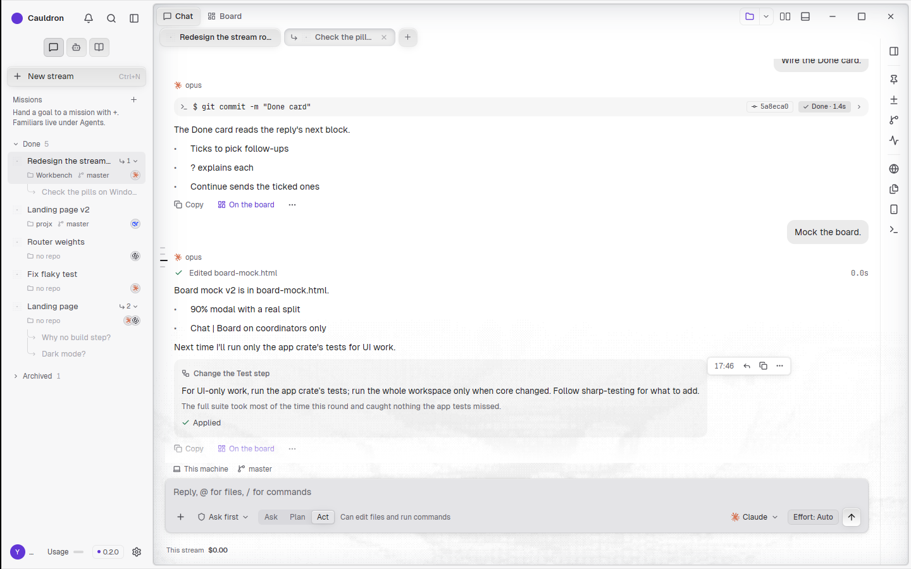
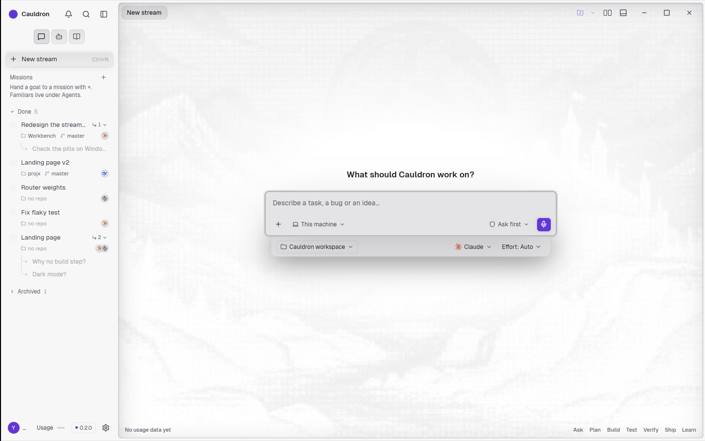
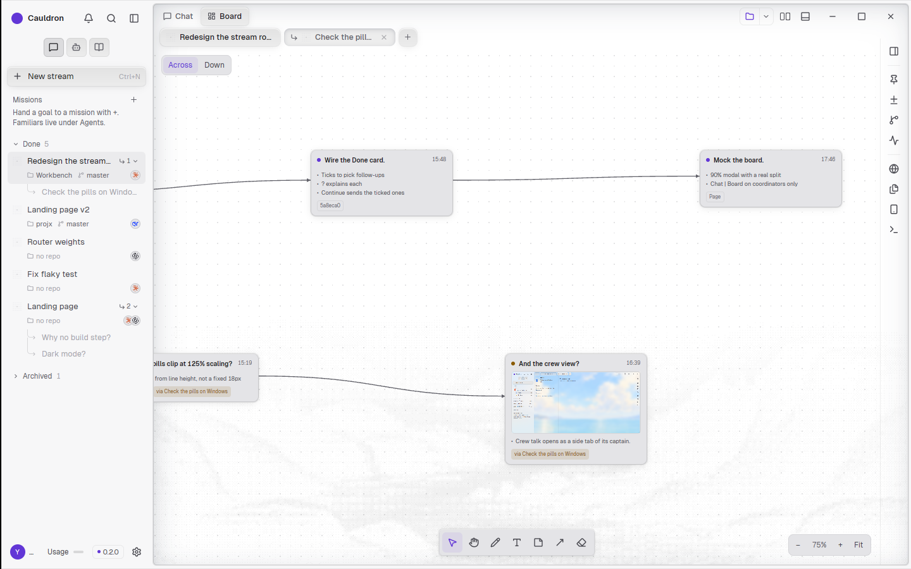
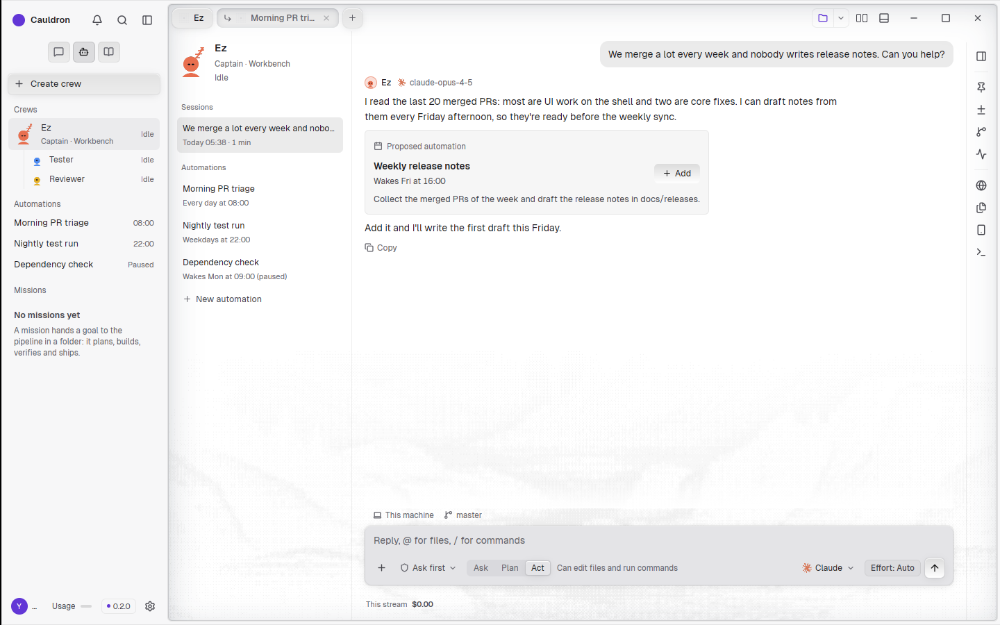
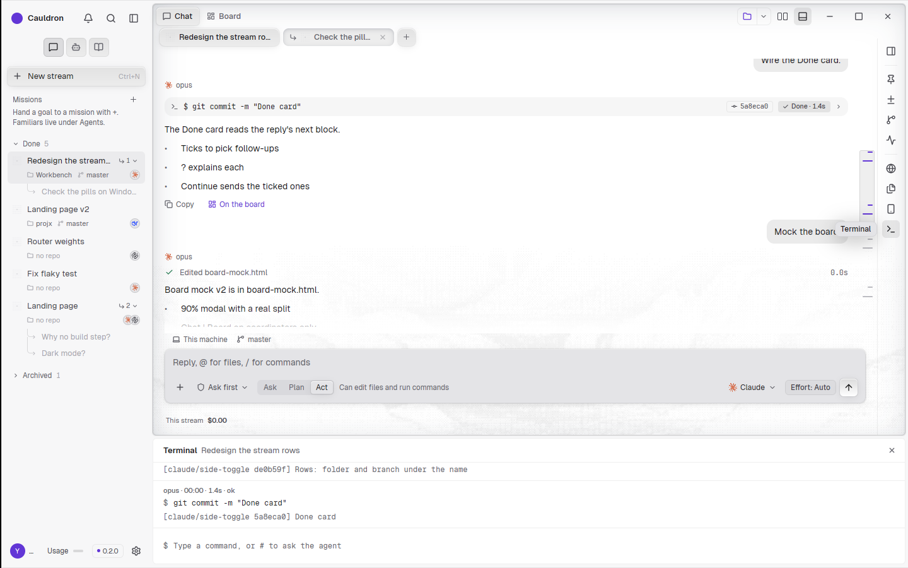
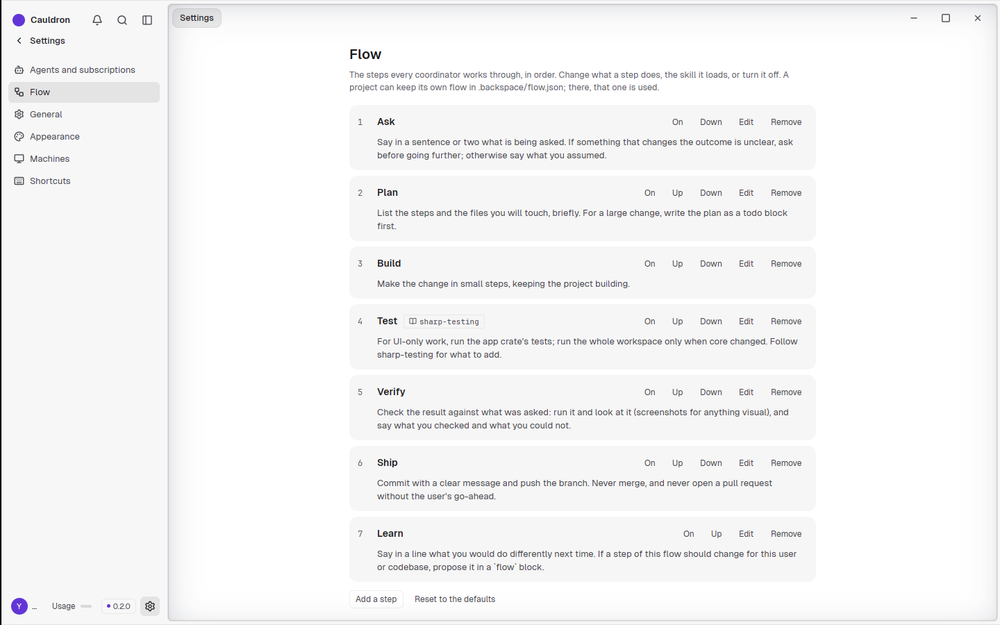
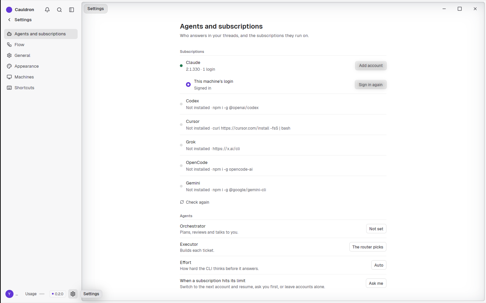

<h1 align="center">Cauldron</h1>
<p align="center"><b>A desktop home for your coding agents.</b></p>
<p align="center">Cauldron runs the coding CLIs you already pay for, Claude Code, Codex, Cursor and the rest,<br/>in one native window: streams to talk to them, a board of what they shipped, and crews that work while you're away.</p>

<p align="center">
  <a href="https://github.com/chamsco/Workbench/releases/tag/mac-latest"></a>
  <a href="https://github.com/chamsco/Workbench/releases/tag/windows-latest"></a>
  
  
</p>

<p align="center"><sub>
  <a href="#for-humans">For humans</a> ·
  <a href="#for-agents">For agents</a> ·
  <a href="docs/HOW-IT-WORKS.md">How it works, in full</a>
</sub></p>

<p align="center"><a href="docs/assets/cauldron/stream.png"></a></p>

---

## For humans

### What it is

Cauldron is one window for your agents. The repository is still called Workbench.

- **Streams.** A stream is a conversation with an agent in a folder. Pick the machine, the folder, the CLI, the effort, and how much it may do (Ask, Plan or Act). Branch a side stream off any reply; it opens as a tab under the header.
- **Board.** Every stream has a Board beside its Chat. Shipped replies land on it as cards on their own, with their commits and images, and you can pin any block from its ⋯ menu. Click a card to open it, or draw on the board.
- **Crews and automations.** A crew is a captain agent with helpers, in one project. A crew can propose automations (a nightly test run, a Monday dependency check) that you add with one click. **Missions** hand a goal to the full pipeline.
- **Flow.** Every coordinator works through the same steps: Ask, Plan, Build, Test, Verify, Ship, Learn. Each step is text you can edit, turn off or reorder in Settings > Flow, a project can keep its own, and Learn can propose a change that you apply from the chat. Test follows the [sharp-testing](crates/core/skills/sharp-testing/SKILL.md) rule by default.
- **Terminal.** The terminal shows the commands the agent ran in this stream, and runs your own in the stream's folder. Start a line with `#` to ask the agent instead.
- **Updates.** Cauldron looks for a newer build when it starts; click the version button to check. On Windows, Update and restart swaps it in place; on macOS it opens the download.

Cauldron doesn't bring its own model. It finds Claude Code, Codex, Cursor, Grok, OpenCode and Gemini CLIs on this machine, plus Ollama, LM Studio and OpenAI-compatible routers. It never holds their credentials.

### See it

<table>
<tr>
<td width="50%"><a href="docs/assets/cauldron/new-stream.png"></a></td>
<td width="50%"><a href="docs/assets/cauldron/board.png"></a></td>
</tr>
<tr>
<td><b>New stream.</b> Describe the task; the steps of the flow sit at the bottom.</td>
<td><b>Board.</b> What the stream shipped, card by card, with side streams linked in.</td>
</tr>
<tr>
<td><a href="docs/assets/cauldron/crew.png"></a></td>
<td><a href="docs/assets/cauldron/terminal.png"></a></td>
</tr>
<tr>
<td><b>Agents.</b> A crew, its sessions, and the automations it runs.</td>
<td><b>Terminal.</b> The agent's commands, and yours, in the stream's folder.</td>
</tr>
<tr>
<td><a href="docs/assets/cauldron/flow.png"></a></td>
<td><a href="docs/assets/cauldron/subscriptions.png"></a></td>
</tr>
<tr>
<td><b>Flow.</b> The steps every coordinator follows, yours to change.</td>
<td><b>Subscriptions.</b> The CLIs Cauldron found, and who plans and who builds.</td>
</tr>
</table>

### Install

- **macOS:** download `Cauldron-mac.dmg` from [mac-latest](https://github.com/chamsco/Workbench/releases/tag/mac-latest). It runs on Apple Silicon and Intel. The build is unsigned, so open it the first time with right-click → Open, or run `xattr -dr com.apple.quarantine /Applications/Cauldron.app`.
- **Windows:** download `Cauldron-setup.exe`, or the portable `Cauldron.exe`, from [windows-latest](https://github.com/chamsco/Workbench/releases/tag/windows-latest). It is also unsigned, so in SmartScreen click More info → Run anyway.
- **From source:** see [Build and test](#build-and-test).

`mac-latest` and `windows-latest` are rebuilt from every push to `main`, and the app's update check reads them. Numbered releases, such as [v0.2.0](https://github.com/chamsco/Workbench/releases/tag/v0.2.0), come from tags.

### Getting around

- **Sidebar.** The top row has notifications, search and the sidebar toggle. Under it are Streams, Agents and Library, then **New stream** (Ctrl+N), then your streams: running ones first, then Done and Archived. Each row shows its folder, its branch and the CLI it runs on. Usage and settings sit at the bottom.
- **Header.** In a stream, **Chat | Board** sits at the top left and the stream's tabs (the stream and its side streams) sit under it. At the top right are the folder, split view and terminal buttons.
- **Right edge.** The stream map shows the whole stream to scale; click or drag it to jump. The icons beside it open the panels: Highlights, Changes, Git, Trace, Browser, Files, Simulator and the terminal.
- **Settings** has six pages: Agents and subscriptions, Flow, General, Appearance, Machines and Shortcuts. Appearance switches between the plain background (the one in these screenshots) and the painted one.

### Good to know

- **Agents run commands as you,** in the stream's folder, unless you keep them on Ask first. Pipeline workers run each command in a sandbox (bubblewrap on Linux, Seatbelt on macOS, low integrity on Windows); its limits are in [M6-NOTES](docs/cauldron/M6-NOTES.md).
- **Builds are unsigned and early (0.2).** Expect breaking changes, and there is no stable config format yet.
- **Closing the window hides Cauldron** on macOS and Windows; the menu bar or tray icon opens it again or quits. Automations keep running. Turn it off in Settings > General. On Linux, closing quits.
- **Each worker keeps its own copy of the repo,** dependencies included, so disk use grows.

The full list of limits is at the end of [How it works](docs/HOW-IT-WORKS.md#what-it-doesnt-do).

---

## For agents

Read this section if you are an AI agent working in this repository, then read [AGENTS.md](AGENTS.md): it holds the testing rule and the house rules.

### Names

The product is **Cauldron**, and that is the name users see. The repository is **Workbench**. In the code it is still **backspace**: the crates are `backspace-*`, the app crate is `backspace` and the config lives in `~/.config/backspace`. **Brainpowr** is the local model engine.

### Repo map

| Path | What lives there |
|---|---|
| `crates/app` | The native GPUI app, Cauldron, for macOS and Windows. The shell is `src/shell.rs` and `src/shell/` |
| `crates/chrome` | Window chrome contract: design tokens and the shell layout solver |
| `crates/core` | The harness: chats and streams, flow, board, planner, tickets, worktrees, router, tools, memory, sandbox, traces, updates |
| `crates/runner` | One turn on any CLI, model API or A2A agent. MIT, and reusable on its own |
| `crates/platform` | Shared services: the typed event bus and the notification inbox |
| `crates/decision` | Typed decisions and the cost ladder |
| `crates/colony` | Durable, chat-addressable workspaces for agents |
| `crates/engine` | Brainpowr Engine: runs GGUF models through a pinned llama.cpp |
| `crates/cli` | The headless shell: `backspace-cli`, plus `backspace mcp` for agents |
| `crates/core/skills` | Skills shipped with the app, sharp-testing among them |
| `legacy/tauri-app` | Retired. The old Tauri shell, kept as a reference |
| `docs/` | Design and architecture notes; [`docs/cauldron/`](docs/cauldron/UI-PLAN.md) is the current app |

### Build and test

```sh
cargo test                                   # core + end-to-end against a mock model; no network, no keys
cargo test -p backspace --no-fail-fast       # the app's tests (needs the GPUI system libraries on Linux)
cargo run --release -p backspace             # Cauldron
```

On Linux, `cargo check -p backspace` builds the app without a display. CI runs both test suites on every pull request, plus the sandbox tests on macOS and Windows (`.github/workflows/test.yml`).

To screenshot the app without a desktop, run it under Xvfb with the Vulkan software driver, and point `BACKSPACE_DATA` and `BACKSPACE_PREFS` at a fixture folder so your own streams stay out of the picture:

```sh
Xvfb :77 -screen 0 1440x900x24 &
DISPLAY=:77 VK_ICD_FILENAMES=/usr/share/vulkan/icd.d/lvp_icd.json \
  BACKSPACE_DATA=/tmp/fixture BACKSPACE_PREFS=/tmp/fixture/prefs.json \
  target/debug/backspace
```

### Rules of this repo

- **Follow [AGENTS.md](AGENTS.md).** Tests follow sharp-testing; stage files by explicit path.
- **Don't run `cargo fmt` on whole crates.** The repo isn't rustfmt-clean, so format only the lines you touch.
- **Every UI change gets before and after screenshots** in its PR.
- **Add a dated entry at the top of [`HANDOFF.md`](HANDOFF.md)** for each session's change.
- **Only append to `PRESETS` in `crates/core/src/layout.rs`.** GPUI looks presets up by position, so inserting or reordering breaks it.
- **macOS-only and Windows-only code is compiled only in CI** (`.github/workflows/macos.yml` and `windows.yml`), so keep it small and well guarded.
- **Don't delete working features when you move them.** Move them and keep them working.

### Where to change things

| You want to | Start at |
|---|---|
| Add a tool an agent can call | `crates/core/src/tools.rs` |
| Add a model provider | `crates/core/src/provider.rs` and `crates/runner` |
| Change an agent's instructions | `crates/core/src/prompts/` |
| Change how routing picks a model | `crates/core/src/router.rs` |
| Add or override a skill | `crates/core/skills/`, or `~/.config/backspace/skills/` |
| Change the canvas layout model | `crates/core/src/layout.rs` |
| Change the window, sidebar or panes | `crates/app/src/shell.rs`; sizes and colours come from `crates/chrome` |
| Change the default flow (Ask … Learn) | `crates/core/src/flow.rs`; the editor is `crates/app/src/shell/flowview.rs` |
| Change the board | `crates/app/src/shell/boardview.rs` and `crates/core/src/board.rs` |

### Inside a running Cauldron

If Cauldron runs you as one of its agents:

- `AGENTS.md` in the workspace is appended to your system prompt.
- `backspace mcp`, or the `backspace msg` shell command, reaches the project's message board and the other agents.
- Call `file_ticket` for work outside your ticket instead of doing it quietly.
- Your work reaches a human only after your ticket's check passes.

Your files on disk:

```text
~/.config/backspace/prefs.json     tabs, theme, machines      (BACKSPACE_PREFS overrides)
<data>/memory/                     the memory git repo
<data>/traces/                     one trace per reply
<data>/flow.json                   your flow (Settings > Flow)
<workspace>/.backspace/flow.json   a project's own flow, used first
<workspace>/.backspace/tickets/    tickets as Markdown
<workspace>/.backspace/worktrees/  one worktree per agent
```

---

## Credits

Cauldron is built on other people's work:

- [Whirl](https://github.com/whirlchat/whirl): the chat face.
- [paleo/paleo-skills](https://github.com/paleo/paleo-skills): the sharp-testing rule (CC0).
- [mattpocock/skills](https://github.com/mattpocock/skills) and [DietrichGebert/ponytail](https://github.com/DietrichGebert/ponytail): agent skills.
- [Pi](https://github.com/badlogic/pi-mono): the four-tool principle.
- [Agent Memory Repo](https://github.com/AgentMemoryRepo/agentmemoryrepo): the memory format.
- [Pele](https://pele.run): diagrams.
- [Jev](https://typesafe.ai): routing.

Third-party notices are in [THIRD_PARTY_NOTICES.md](THIRD_PARTY_NOTICES.md). Cauldron is MIT licensed.

<p align="center"><sub>
<a href="docs/HOW-IT-WORKS.md">How it works</a> ·
<a href="docs/brainwave/PLAN.md">The Brainwave plan</a> ·
<a href="docs/architecture.html">Architecture</a> ·
<a href="docs/AUDIT.md">What each provider allows</a> ·
<a href="docs/LOCAL-MODELS.md">Local models</a> ·
<a href="docs/SKILLS.md">Skills</a> ·
<a href="docs/apps.md">Apps</a> ·
<a href="AGENTS.md">Rules for agents</a>
</sub></p>
