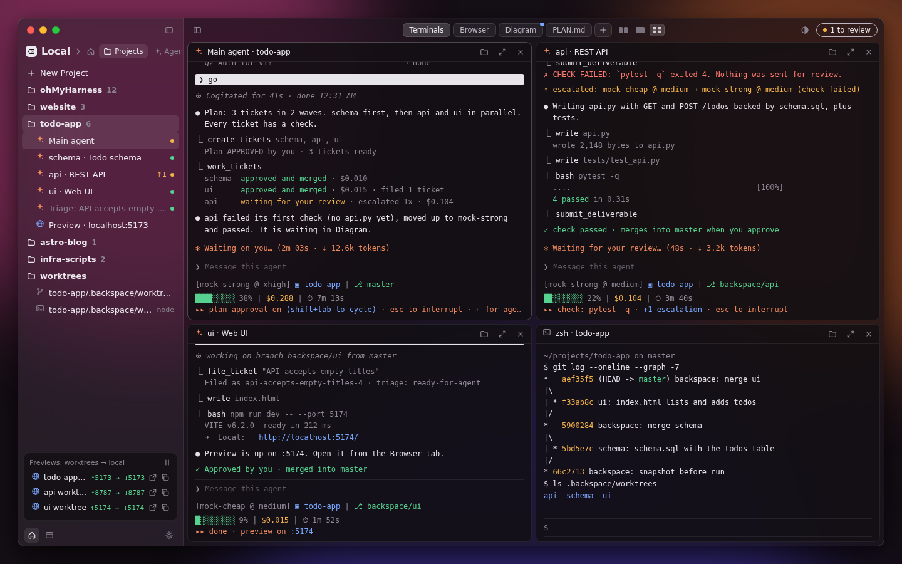
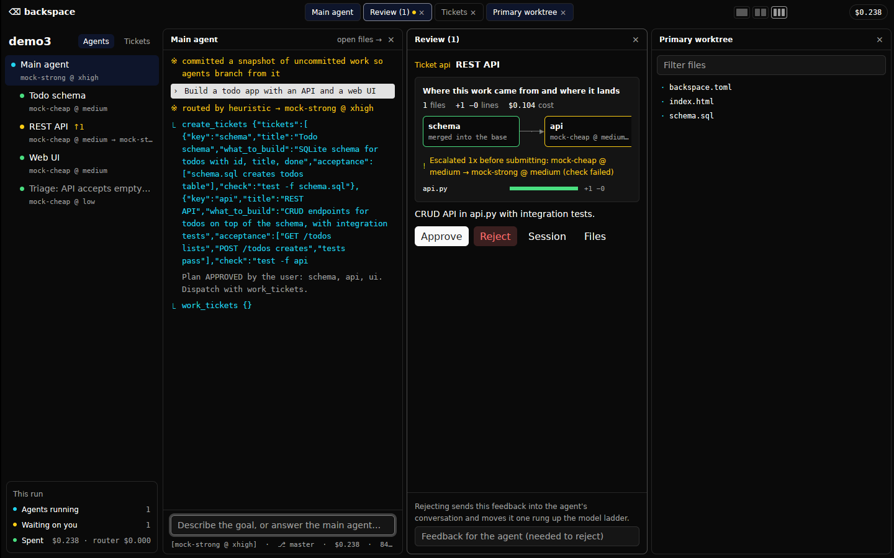

# backspace

A mixture-of-models agent harness with a GPUI desktop shell. You state a goal to
one **main agent**; it interviews you, turns the goal into tickets you approve,
and runs each ticket with its own agent on its own git branch. Work passes an
automatic check before it reaches you; you approve or reject with feedback, and
accepted work is merged.

Each agent is routed separately: [Jev](https://typesafe.ai) (TypeSafe's System One
decision model, ~$0.04/M tokens) picks **which model** and **what effort
level** (`low → medium → high → xhigh → max → ultra`) fit that agent's brief.
Without a Jev key a keyword heuristic stands in. Either way the pick is only a
starting point: agents start cheap and climb the ladder on evidence of failure.


**Design target:** [`design/workbench.html`](design/workbench.html) is a single-file, clickable replica of where the desktop app is heading: frosted macOS window, environment tabs (terminals up to 2x2, live worktree previews, diagram review, PLAN.md), resizable splits, light and dark.



**Architecture map:** open [`docs/architecture.html`](docs/architecture.html) in a browser for a zoomable map of the whole flow, with the code location of every step.

## Layout

```
crates/runner one turn on any CLI, Ollama, OpenAI-compatible API or A2A agent (MIT, reusable)
crates/core   harness: router, providers, tools, tickets, git worktrees, skills, accounts, local models
crates/colony durable, chat-addressable workspaces (WSL2 / Hyper-V) as `colony_*` tools
crates/cli    headless shell (logs to stdout, approvals on stdin)
crates/app    desktop shell, GPUI (native)
crates/tauri-app  desktop shell, Tauri 2 (the design's HTML in the system webview)
capsule/      Colony's hypervisor core: visor-core (Rust JSON CLI) + agentd (Go, :7700)
apps/         app SDK (sdk.js) and the Prompt Lab example app
design/       workbench.html: the design both shells reproduce
bench/        GPUI vs Tauri benchmark (see bench/README.md)
```

## Desktop app

Two shells draw the same interface over the same in-process harness. Pick
one after reading the benchmark in `bench/README.md`:

- `backspace` (GPUI): native, starts about 5× faster and uses less memory.
  It has no web engine, so a browser canvas shows a text snapshot of the
  page and opens the page itself in your browser.
- `backspace-tauri` (Tauri 2): HTML/CSS/JS in the system webview, with live
  dev-server previews inside the app.

`design/workbench.html` is the original static mock; the shells have moved
past it (tabs of canvases, machines, settings).

- **Tabs** sit on the left of the title bar. Each holds one to four
  canvases. `+` opens a new tab with a name and a layout (1, 2, 3, 2×2,
  1 over 2, 2 over 1, 1 | 2); unnamed tabs show their actual arrangement.
  Drag a tab to reorder. Right-click or double-click a tab to rename,
  duplicate or close it.
- **Canvases** show an agent session, a worktree, a browser, the diagram
  review, PLAN.md, visual options, a conversation, or a **terminal** — a real
  shell (a PTY: ConPTY on Windows, forkpty elsewhere) started in the open
  project's folder, drawn as plain text, so a build, a git command or a REPL
  runs where the work is. The `+` on the right adds one (it splits the focused
  canvas); an empty canvas offers a picker. Drag the gaps to resize,
  double-click a gap to even it out. A canvas holds no chat: Home starts a
  project by a task, the picker starts one by view.
- **Arranging:** drag a canvas by its header. A dotted `+` slot shows where
  it will land and the other canvases slide out of the way as you move.
  Over the middle of another canvas it swaps places with it; over an edge
  (the outer quarter) it splits that canvas on that side. Drop it on another
  tab to move it there. Esc cancels. The arrangement is a split tree
  (`crates/core/src/layout.rs`), saved per tab in prefs.json.
- **Tickets** open in a drawer from the review pill in the sidebar (under
  the run's spend): hover a moment, or click to pin. File tickets there, and
  open one for its details. "Check for updates" sits just below it.
- **Machines** switch from the sidebar foot (laptop = this machine, cloud =
  a followed one; `+` adds one). The sidebar title shows which machine you
  are looking at.
- **Settings** (gear) cover providers, the Cloud plan, which harness runs
  workers, accounts, local tiny models, skills, worktrees, Colony workspaces,
  API keys, projects, what the app is used for, appearance (accent, colours,
  fonts, contrast), machines, sharing this machine, and update checks. The
  panel is a grouped left nav — Personal, Integrations, Coding, System — with
  one section at a time beside it.

Tabs, theme and machines live in `~/.config/backspace/prefs.json`, shared by
both shells (`BACKSPACE_PREFS` overrides the path).

### Zones

A rail of squares on the far left (Slack/Discord-style) switches zones:
**Chat**, **Code**, **Memory**, **Apps**, then any app pinned from the
catalog, and **Settings** at the foot. Hover a square for its name; the
first square lines up with the view switcher at the top of the sidebar. Each zone keeps its state while
another shows. The split button in the title bar opens a second zone or
app beside the current one (drag the gap to size it, swap sides, close).

The title bar follows the OS: macOS keeps its traffic lights (drawn over
the top of the rail); Windows and Linux run undecorated with their own
caption buttons (flush rectangles on Windows, round ones on Linux, plus
resize edges on Linux).

### Setup, Chat and Coding

First run walks through setup (skippable; "Run setup again" in Settings):
add the apps Backspace starts with (Chat, Code or both; at least one, and
either can be added or removed later under Apps → Built in), then the scan of coding CLIs on this machine
(Codex, Claude, Cursor, Grok, OpenCode, Antigravity: version, signed in or
not, plan where it can tell) with a switch per CLI, then your first agent,
then Ollama and any OpenAI-compatible routers, then an optional Cloud plan.
`backspace-cli scan` prints the same scan. A CLI that is installed but signed
out gets a sign-in button (Sign in with ChatGPT for Codex, Claude Code,
Cursor, OpenCode) that opens the CLI's own login in a terminal; Backspace
never sees the credentials. See [`docs/AUDIT.md`](docs/AUDIT.md) for what
each provider allows.

**Chat** (Tauri shell) is a port of [Whirl](https://github.com/whirlchat/whirl)'s
React chat face (MIT; `crates/tauri-app/web`, built into
`ui/chat-web/whirl.{js,css}` with `npm run build`), frosted over the window.
A thread answers from one of:

- a coding CLI you are signed in to, headless, on your own subscription
  (Claude resumes its session between turns);
- a model in Ollama, or any router (OpenRouter, LM Studio, vLLM, LiteLLM);
- **Backspace Cloud**: Free (50 replies a day, small models, one sponsored
  card under each reply), Plus ($8/month: 1,500 replies with no ads on small
  and standard models, then small models with ads) or Max ($30/month: 5,000
  replies, every model, then ads or pay as you go). Ads are a separate card,
  never inside an answer, and are not chosen from what you type.
  `crates/core/src/cloud.rs` holds the rules; `backspace-cli cloud` runs a
  development server (`BACKSPACE_CLOUD_MOCK=1` for canned replies).
  Nothing is billed yet.

The composer switches the model per thread, attaches files, and `@codex`
(or any CLI id) sends one reply to another CLI. Threads can be retried,
edited, branched, pinned and renamed. They are JSON files under the data
dir (`BACKSPACE_DATA` overrides).

Messages take a tapback (the six iMessage ones), can be answered
specifically (the reply quotes it, and the model sees the quote), show a
preview card for their first link, and can be saved to Memory.

**Chat** has two views, switched at the top of its sidebar: **Chat** (the
threads above) and **Agents**:

- An **agent** has a name, a job (its brief), an avatar, a model and its
  own folder (`<data>/agents/<id>/workspace`), plus any folders you share
  with it. A 1:1 chat with an agent runs a coding CLI in that folder with
  leave to edit it, and the agent's brief and its own memory as the system
  prompt.
- A **group** has members and a goal. Each message gets sequential turns:
  the members you name (`@Kira`) first, otherwise everyone in order; a
  member with nothing to add says PASS and leaves no message, and one that
  names another hands it a turn (at most 8 turns per message). Members read
  the group's transcript; no CLI session is kept between turns.
- **Computer use**: an agent can have a computer (a plain folder, a Docker
  container `backspace-agent-<id>` with its home mounted, or a VPS over
  SSH). It reaches it through the `computer_run`, `computer_read` and
  `computer_write` tools of `backspace mcp`. With "desktop" on, the
  container runs a web desktop (`linuxserver/webtop`) that opens beside the
  chat.

**Code** has two views, switched at the top of its sidebar:

- **Pair**: you and one coding CLI, turn by turn, in the open project. The
  CLI runs in the project folder with leave to edit files and run
  commands (Claude Code with `acceptEdits`, Codex `--full-auto`, Cursor
  `--force`). Its threads belong to the project.
- **Workbench**: a planner splits the goal into tickets and workers build
  them (below).
  Its title bar switches between **Canvases** (tabs of split canvases),
  **Wall** (every agent's live session tiled, however many there are) and
  **Inbox** (what needs you, then what is running, then what is done).

**Workbench** opens a folder as a project. Workers run on the router's pick or,
when Settings → Coding names one, on a coding CLI (Claude Code, Codex,
Cursor, Grok, OpenCode) inside the ticket's worktree; their work goes through
the same check, review and merge, and review feedback goes back to the CLI
(up to four rounds). The planner still needs an API model (Anthropic or
OpenRouter key, set in Settings or the environment).

**Agents talk to each other** through a per-project message board. API
agents get `list_agents`, `send_message`, `dm`, `read_messages` and
`read_conversation` tools; CLI workers get the same through an MCP server
(`backspace mcp`) or the shell (`backspace msg agents|send|read|conversation`),
both reaching a token-protected bridge on 127.0.0.1. Address an agent by its
key or its ticket's key. A message can answer another (`reply_to`, or
`msg send <key> --reply <id>`), and everything two agents say to each other
lands in one conversation. The board shows as the "Team chat" canvas and each
pair's thread as the **Conversation** canvas.

**Several accounts per CLI, with failover.** Settings → Accounts keeps one
profile directory per login, pointed at the CLI's own variable
(`CLAUDE_CONFIG_DIR`, `CODEX_HOME`, `GEMINI_CLI_HOME`, `COPILOT_HOME`,
`CURSOR_CONFIG_DIR`, `XDG_DATA_HOME`), and tracks health per login. On
**Automatic**, when a CLI reports a *confirmed* usage limit the login is
parked and the next turn runs as the next healthy one — never on a plain rate
limit. Backspace never holds the credential: each login signs in to its own
profile directory. Code: `crates/core/src/accounts.rs`.

**Small local models do the small jobs.** Settings → Local models finds
Ollama, LM Studio, llama.cpp and MLX (plus any loopback OpenAI endpoint),
lists what each one has, marks the models ≤ 4B as tiny, and suggests the one
to hand a small job to. Pick one and it becomes the model scouts and other
delegated read/classify/summarise/extract work runs on, whatever subscription
model is leading. Nothing is downloaded for you; if the runtime is not up, the
router's own pick is used. Code: `crates/core/src/model_server.rs`.

**An agent can be given a machine of its own.** Colony gives an agent a
durable, chat-addressable workspace — a WSL2 distro or a Hyper-V VM created on
demand, used through `colony_create` / `colony_exec` / `colony_list` /
`colony_status` / `colony_destroy`, and destroyed when the task is done. It
drives the `visor-core` JSON CLI that lives in `capsule/`; without it the tools
are simply not offered. Design, the industry landscape it borrows from, and
what is and is not tested: [`docs/COLONY.md`](docs/COLONY.md) and
[`docs/DURABLE-OBJECTS-2026-10.md`](docs/DURABLE-OBJECTS-2026-10.md).

**Agents can show you visual options.** `show_options` puts two to six variants
of a design, a layout or a change on screen — each an image the agent wrote (a
screenshot) or a live page — and waits. The Options canvas draws them as a row
of thumbnails with a Choose pill and the agent's note under each; a Compare
switch opens two of them side by side with a draggable split. Your pick comes
back to the agent as that tool's result, so it can carry on with the version
you chose. CLI workers get the same tool through `backspace mcp`. Code:
`crates/core/src/options.rs`, `optionsPane` in `crates/tauri-app/ui/app.js`.

### Bring your agent

Backspace hosts agents rather than being one. Setup's "Your first agent"
step (and Chat → Agents, Settings → Coding CLIs and models) offers:

| Pick | How it connects |
|---|---|
| Backspace sidekick | Made here: a name, a job, and any CLI or model you have |
| Claude Code, OpenAI Codex | The CLI on this machine, on your own subscription (Codex is the open-source harness OpenAI's Dots run on) |
| Grok, Meta Muse | xAI's and Meta's OpenAI-compatible APIs with your key (`api.x.ai/v1`, `api.meta.ai/v1`), added as routers |
| Any A2A agent | Paste the address of its agent card; Backspace sends `message/send`, keeps its `contextId`, waits on its tasks |

Every one becomes a named agent: own folder, own memory (off by default
for remote agents, whose notes would leave the machine), a seat in groups,
traces and Carry on. OpenAI Dots, Grok Bot and Tencent WorkBuddy are
consumer apps with no outside API to drive them, so they aren't offered.

All of it runs through `crates/runner`: build a `Request`, get `Event`s
(text, tool calls, session, tokens, cost). It knows nothing about chats,
so another app (Anarchy's sidekick, say) can depend on it.

### Traces

Every reply is a trace and every tool call a span (OpenTelemetry shape,
GenAI attribute names), kept in `<data>/traces/`. The timeline button
under a reply shows the waterfall with each tool's input and output, the
model, tokens and cost. Settings → Tracing sends traces to any OTLP/HTTP
collector (treg, Jaeger, Langfuse…), without prompts or output unless you
allow it, and can send a test trace.

### Carry on

A reply cut off by quitting (or by Stop) can be resumed: what was written
is saved before and after each tool call, and Carry on picks it up on
Claude Code's own session, or from the conversation plus the partial
answer for everything else. The agent is told to check what's already
done instead of redoing it.

### Memory

Short notes every chat and agent gets ("use pnpm, never npm"): global,
tied to one project, or kept by one agent. Chats get the global notes plus
their project's (or their agent's), ranked by importance, use and age, as a
system prompt; a project's planner and workers get them when it opens.
Add them in the Memory zone, or with Remember on any message. One switch
turns them off without deleting them.

**Stored as an [Agent Memory Repo](https://github.com/AgentMemoryRepo/agentmemoryrepo):**
a git repo of Markdown in `<data>/memory`, one commit per change:

```text
memory/
  MEMORY.md                  # global notes, then ## Index linking the rest
  projects/<name>-<hash>.md  # "# Project: /abs/path"
  agents/<id>.md             # "# Agent: <id>"
```

Each note is a bullet with metadata:
`- The user prefers short answers [id: …; added: 2026-10-06; kind: preference; source: backspace://thread/…]`.
You (or Claude Code, Devin, any agent with the AMR skill) can edit the
files directly; Backspace picks the change up, keeps bullets and index
lines it did not write, and leaves other files (topic notes, SQL) alone.
Add a private remote yourself to sync it between machines. Use counts and
the scorer's features stay outside the repo (`memory-state.json`).

**Agents read and write it themselves.** Agents and Pair threads get
`memory_search` (notes plus any topic file) and `memory_save` (one line,
into the agent's own notes or the project's) through `backspace mcp`.
Saves that look like credentials are refused. Their notes show as "Saved
by the agent".

**It notices things on its own** ("from now on…", "remember that…",
"I prefer…", "we deploy with…"). A small logistic model on this machine
(`crates/core/src/memory_learn.rs`, no network) scores each message; above
its threshold the note is saved in the third person, tagged as a
preference, fact or instruction, and a toast says who will remember it.
"Don't remember that" deletes it, trains the model away from it, and is
remembered: the same thing is never noticed or tidied back in. Closing the
toast confirms it. Near-duplicates are merged.

**It can tidy itself ("dreaming"), off by default.** With "Tidy once a day" on in Memory, about once a day, when you have said
enough since the last time and no chat is busy, your default chat model
(or Claude Code) reads what you said since the last tidy next to what
memory holds, and in one commit merges duplicates, rewrites or removes
notes that are out of date or contradicted, and adds what you made clear
but nothing caught (at most 8, each citing its chat). Notes you wrote are
never deleted by a tidy, only turned off. Memory → Tidy now runs it on
demand; Tidy history lists every change with its reason and an Undo (a
git revert). Code: `crates/core/src/memory_dream.rs`.

### Status bar

The foot of the window shows the branch, the project and its ticket
count, who is working or replying, the split, the phone link, a motion
toggle (Full or Reduced) and the tokens and cost so far.

### Apps

Views with their own agent that anyone can make: a folder with a
`backspace-app.json` and a page. Install from a link to the manifest or
from a folder; open from Apps, pin to the rail, or put one beside a chat.
The page runs sandboxed and talks to Backspace through `apps/sdk.js`: ask
models the user has on (`backspace.agent.ask`), keep data, notify. Apps
can also give coding CLIs tools through `backspace mcp`. Format, SDK and
security model: [`docs/apps.md`](docs/apps.md). Example:
[`apps/prompt-lab`](apps/prompt-lab) asks two models the same prompt.

### Phone

Settings → Phone opens a token-protected API on the local network and
shows a QR code to pair the Backspace phone app (not built yet): chats,
tapbacks, Memory, and a project's approvals. Protocol and plan:
[`docs/companion.md`](docs/companion.md).

### Following other machines

Run the harness headless on any machine and share it:

```sh
BACKSPACE_TOKEN=... backspace-cli serve ~/projects/my-app 127.0.0.1:7420
```

Then add it from Settings → Machines with its address and token. You see its
agents, tickets and reviews live, and can talk to its main agent and
approve or reject from your machine. A desktop shell can share its own
harness the same way (Settings → Share this machine). The API is plain HTTP
with a bearer token, so keep it on localhost behind an SSH tunnel
(`ssh -L 7420:127.0.0.1:7420 box`) or on a private network such as
Tailscale.

**Every review starts with a diagram the harness draws from its own data**,
never one the agent drew:

- *Plan*: the ticket graph in waves, how many run in parallel, which tickets
  have no check.
- *Ticket*: the blockers it built on, the model path (including escalations),
  the check that passed, where it merges, and exact per-file line counts.
- *Final*: every ticket with its state and route, plus anything left open.



## Principles (after Pi)

- **Four tools**: `read`, `write`, `edit`, `bash`. Everything else goes through bash.
- **Config is the product**: one TOML file, no hidden merging. Models, prices,
  descriptions (what Jev reads to choose), providers, caps. `backspace-cli init-config`
  writes the default to `./backspace.toml`.
- **`AGENTS.md`** in the workspace is appended to every agent's system prompt.
- Two wire formats cover most models: Anthropic Messages and OpenAI-compatible
  Chat Completions (OpenRouter, Ollama, vLLM, ...).

## Run

Needs Rust ≥ 1.98 (gpui-pre uses APIs that 1.94 rejects). On Linux:
`libxkbcommon-dev libxkbcommon-x11-dev libwayland-dev libvulkan-dev libfontconfig-dev`.

```sh
export ANTHROPIC_API_KEY=...     # and/or OPENROUTER_API_KEY
export TYPESAFE_API_KEY=...      # optional: Jev routing
cargo run --release -p backspace -- ~/projects/my-app     # GUI (GPUI)
cargo run --release -p backspace-tauri -- ~/projects/my-app   # GUI (Tauri; Linux needs libwebkit2gtk-4.1-dev)
cargo run --release -p backspace-cli -- ~/projects/my-app "build ..."
cargo run --release -p backspace-cli -- serve ~/projects/my-app     # share it
cargo run --release -p backspace-cli -- scan                        # coding CLIs, Ollama, routers
cargo run --release -p backspace-cli -- cloud                       # dev Cloud server on :7430
(cd crates/tauri-app/web && npm ci && npm run build)                 # after editing the chat face
cargo test                                                 # core + e2e (mock model)
```

## How a project runs

1. **Grill.** Your first message is the goal. The main agent interviews you in
   rounds (mattpocock `grilling`): numbered questions, each with its recommended
   answer, so "go" accepts them all. Turn off with `workflow.grill = false`.
2. **Plan as tickets.** It writes `PLAN.md`, then `create_tickets` (mattpocock
   `to-tickets`): vertical slices with acceptance criteria, `blocked_by` edges
   and, ideally, a `check` command. **You approve the plan** before any work
   starts (`workflow.plan_approval`); a rejected plan is discarded and redone.
3. **Dispatch.** `work_tickets` starts one agent per ticket, in parallel,
   respecting `blocked_by`.
4. **Isolate.** Each ticket agent gets its own branch (`backspace/<key>`) and
   git worktree (`.backspace/worktrees/<key>`), forked from its parent's branch
   *after* its blockers were merged, so it builds on their work.
5. **Gate.** On `submit_deliverable` the harness commits the worktree and runs
   the ticket's `check`. A failing check bounces straight back to the agent;
   nobody reviews broken work.
6. **Review and merge.** You approve or reject (with feedback) each top-level
   ticket; the card shows the `git diff --stat`. Accepted work is merged into the
   parent's branch. A merge conflict is handed back to the agent with the exact
   `git merge` to run.
7. The main agent verifies the merged result and submits the final deliverable.

### Orchestrator, advisor, scouts

Plan on high, delegate on medium, keep Opus on call (`[advisor]` in the config):

- **Sonnet leads.** The main agent is pinned to Sonnet at high effort (when an
  Anthropic key is set; otherwise the router or a CLI takes the lead).
- **Opus advises.** Agents on the Anthropic API get the server-side `advisor`
  tool (Opus 5.5), consulted before a plan locks, when the same check fails
  twice (the harness says so), and before work is called done; never on
  routine steps. Agents in Claude Code run with `claude --advisor opus`.
- **Haiku scouts.** A `scout` tool sends up to three small, fast, read-only
  agents in parallel to find files and read code or docs; in Claude Code a
  `scout` subagent on Haiku does the same. Scouts show on the Wall.

Agents can also open and close canvases (`open_canvas`, `close_canvas`): a
browser on the dev server they started, their files, a session. **Ctrl ↵**
on Home starts another task in parallel, on its own branch.

### Start cheap, escalate on evidence

The router's pick is a *prior*, capped at `escalation.start_max_effort` /
`start_max_tier` (default `medium`, tier 2). An agent moves one rung up (more
effort while below `high`, then the cheapest stronger model, then more effort)
only on evidence:

- its ticket's check failed,
- a reviewer rejected it or sent it back with `revise_ticket`,
- it made the same tool call `loop_repeats` times in a row,
- it exhausted its turn budget.

At most `max_steps` rungs. Every finished ticket appends its route, escalations,
cost and outcome to `.backspace/outcomes.jsonl`: the data to learn routing from
later, instead of guessing from briefs.

### Tickets and triage

Tickets live in state and are mirrored to `.backspace/tickets/NN-key.md`
(mattpocock's local-tracker format), states `proposed → ready-for-agent →
queued → in-progress → in-review → done`, plus `needs-triage`, `needs-info`,
`ready-for-human`, `failed`, `wontfix`.

Agents call `file_ticket` for anything outside their scope instead of fixing
it; you can file from the Tickets tab. A **triage agent** (read-only, forced to
`low` effort) verifies the claim, checks for duplicates and classifies it
(mattpocock `triage`). Ready ones show up in the owner's next `work_tickets`
report.

### Nested teams (after Paperclip)

- Agents above `max_depth` (default 2) can create and dispatch their own
  sub-tickets: main → leads → their reports. Sub-branches fork from and merge
  into the lead's branch.
- **Review follows the org chart.** Tickets at depth ≤ `human_review_depth`
  (default 1) come to you; deeper ones go to the agent that planned them, which
  verifies in its worktree and can reopen one with `revise_ticket`.
- **Goal ancestry.** Every brief carries the chain of goals up to the project goal.
- **Budgets.** `budget_usd` on a ticket caps that agent *and its subtree*;
  `max_project_usd` caps the project.

### Skills

Vendored from [mattpocock/skills](https://github.com/mattpocock/skills) (MIT,
commit in `crates/core/skills/UPSTREAM`): `grilling`, `to-tickets`, `triage`,
`tdd`, `diagnosing-bugs`, `code-review`. Also vendored, from
[DietrichGebert/ponytail](https://github.com/DietrichGebert/ponytail) (MIT):
`ponytail` — "the lazy senior dev": the smallest change that fully solves the
task, one test for anything non-trivial, and a note on what was skipped. It is
injected into implementation workers by default (`workflow.worker_skills`).
Each role gets some injected (`workflow.*_skills`); every agent can load any of
them with the `skill` tool. Drop a folder with a `SKILL.md` into
`~/.config/backspace/skills/` or `<workspace>/.backspace/skills/` to override
one or add your own. The files are kept verbatim; a short adapter note maps
their vocabulary (the Skill tool, issue tracker, sub-agents, ponytail's slash
commands) onto Backspace.

State is written to `<workspace>/.backspace/state.json` as a record of the run.
`.backspace/` ignores itself in git.

## Known limits

- No sandbox: `bash` runs as you, in the workspace. The file tools refuse paths
  outside it; bash does not. Run it in a container or VM for untrusted goals.
- Not resumable: closing the app ends in-flight agents. `state.json` is a log,
  not a checkpoint.
- Non-streaming requests; long single turns show up only when they finish.
- The workspace must be a git repo (one is created if not). Uncommitted work is
  committed as `backspace: snapshot before run` so agents can branch from it,
  and agents' work is merged onto the branch you have checked out. Use
  `isolation = "shared"` to skip git entirely.
- Worktrees are kept after the run (for reopening tickets); each has its own
  copy of dependencies (`node_modules`, `target/`), which costs disk.
- Merge conflicts are handed back to the agent, but that path is only covered
  by the git unit test, not the end-to-end tests.
- The heuristic router is crude by design; routing quality comes from Jev.
- Chat, setup, Cloud, Memory, Apps, the rail and the phone link exist only
  in the Tauri shell; the GPUI shell has the coding workbench only.
- The phone app does not exist yet; only its link and API do. The link is
  plain HTTP on the LAN with a token (use Tailscale away from home).
- App tools run as you, like any program you install.
- The headless flags for Codex, Cursor, Grok, OpenCode and Antigravity
  follow their docs but were only exercised against Claude Code.
- Group turns run one after another, so a group of four is about four
  times as slow as a 1:1 chat.
- Agent computers were tested with Docker (alpine); the web desktop image
  (about 1.5 GB) and the SSH/VPS path are untested. A Docker computer is
  not a security boundary against a determined agent.
- The memory scorer starts from hand-set weights and learns only from
  your "Don't remember that" and confirmations; expect misses early.
- A tidy sends your recent messages from every chat to your default chat
  model in one prompt, which is why the daily tidy is off by default.
- Memory's git repo has no remote by default; syncing it between machines
  is up to you (`git remote add` a private repo).
- Tracing to treg is untested: its docs couldn't be reached from the build
  machine. It's sent as standard OTLP/HTTP JSON, which treg may or may
  not accept as is.
- A2A: `message/send` with polling only; streaming (`message/stream`),
  push notifications and file parts aren't used yet. Tested against a
  local agent, not a public one.
- Carry on resumes Chat replies. Workbench workers still don't resume
  after a restart, and only Claude Code resumes on its own session
  (others get the transcript).
- Colony: the registry, the tool wiring and the account/local-model paths are
  tested without a VM (`crates/colony` has 25 tests; `crates/core/tests/features.rs`
  covers conversations, the local scout model and account failover), but
  `visor-core` itself has only been exercised by hand on this machine
  (`capabilities`, `list`, `status`). Hyper-V needs an elevated host;
  `colony_exec` is WSL only, and snapshots, GC and a guest agent are not built.
  See [`docs/COLONY.md`](docs/COLONY.md).
- The terminal canvas is a PTY, not an emulator: it draws plain text, so
  full-screen TUIs are not the point, and the shell starts in the open
  project's folder. On a locked-down Windows host ConPTY can open without ever
  producing output; the canvas says so instead of sitting blank, and
  `crates/tauri-app` has a test that pins the invariant (spawn + drain, or
  report) rather than assuming the host talks.
- Multi-account failover moves between logins when the CLI reports a usage
  limit; it does not yet checkpoint and resume a CLI session mid-turn, so a
  turn that dies on a limit is re-asked on the new login.
- The local tiny model runs the scouts (`advisor.scout_model` when
  Settings → Local models names one). Other delegated jobs still go through the
  router, which picks the cheapest *usable* model, local ones included.
- Cloud is a development server: no accounts beyond a local token, no
  billing.
