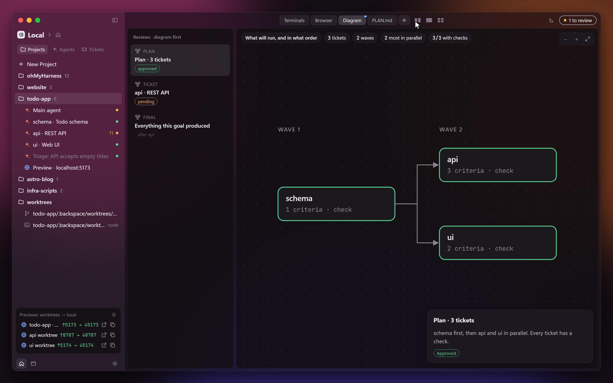

<h1 align="center">Workbench</h1>

<p align="center"><b>Say what you want built. A team of AI agents plans it, builds it in parallel,<br/>checks its own work, and hands you a diff to approve.</b></p>

<p align="center">
  <a href="https://github.com/chamsco/Workbench/releases/tag/mac-latest"></a>
  
  
  
</p>

<p align="center"><sub>
  <a href="#what-this-is">What this is</a> ·
  <a href="#see-it-move">See it move</a> ·
  <a href="#quick-start">Quick start</a> ·
  <a href="#how-it-works">How it works</a> ·
  <a href="#decision-models">Decision models</a> ·
  <a href="#under-the-hood">Under the hood</a> ·
  <a href="#what-it-doesnt-do">Limits</a>
</sub></p>

<p align="center"><a href="docs/assets/app-ade.png"></a></p>

<p align="center"><em>The ADE workspace — one prompt, one row of tabs, and the agents already working. Chat, memory, tickets, and diffs share the same window.</em></p>

> **About the name.** This was called *backspace* (and briefly *ohMyHarness*).
> That name is still in the code — the crates are `backspace-*`, the config lives
> in `~/.config/backspace`. Workbench is the product, `backspace` is the plumbing.
> Same thing.

---

## What this is

Point it at a folder and type a sentence.

> *"Users should be able to sign up and log in."*

It asks you a few numbered questions, each with a suggested answer, so it stops
guessing and you stop typing. Then it writes a plan: small tickets, each with a
definition of done and, ideally, a command that proves it.

You approve the plan. One agent starts per ticket — in parallel, each on its own
branch and its own copy of the repo, so three agents can't overwrite each other.
When an agent says it's finished, its check runs. If the check fails, the work
goes straight back to that agent. You never see it.

What reaches you is a diff. Approve it, and it merges.

**That's the whole loop, and it has two decisions in it: approve the plan,
approve the diff.** Everything in between is automatic.

<details>
<summary><b>New to this vocabulary? Eight words, defined</b></summary>

| Word | What it means here |
|---|---|
| **Agent** | One model or CLI with a brief, a folder, and a job. Agents are cheap; you run several. |
| **Ticket** | One small, reviewable piece of the goal, with acceptance criteria and usually a check. |
| **Check** | A command (`test -f api.py`, `pytest -q`) that has to pass before a human looks at the work. |
| **Blocked by** | Ticket B can't start until A is merged, because B builds on A's code. |
| **Worktree** | A second copy of your repo on disk, on its own branch, so two agents never share files. |
| **Canvas** | One pane in the window: an agent session, a browser, a terminal, the review. |
| **Harness** | The machinery around the model: tools, isolation, checks, review, memory. |
| **Router / Jev** | What decides which model and how much effort a given job deserves. |

</details>

### Why not just use a chat window?

The model is the easy part — bring whichever one you already pay for. What a chat
window doesn't give you is everything *around* the model.

| A chat window gives you | Workbench gives you |
|---|---|
| One conversation at a time | Several agents at once, isolated from each other |
| Code pasted into a reply | Real branches, real worktrees, real merges into your repo |
| "I've finished" | A command that has to pass before you're asked to look |
| A wall of text | A diff, a line count per file, and a diagram of what ran |
| Trust that it read the right files | A trace of every tool call, with tokens and cost |
| Nothing, tomorrow | Memory that survives, and work you can resume |

It's a workshop around your models, not another chatbot.

### See it move

<p align="center"></p>

<p align="center"><em>A real run, captured from the app: four agents working, then the Wall of every agent, then what a canvas can be.</em></p>

## Quick start

**The Mac app.** Download the `.dmg` from
[the latest build](https://github.com/chamsco/Workbench/releases/tag/mac-latest)
(Apple Silicon and Intel in one bundle). It is **unsigned**, so the first launch
needs right-click → Open, or:

```sh
xattr -dr com.apple.quarantine /Applications/Backspace.app
```

**From source.** Rust ≥ 1.98 (the GUI stack uses APIs 1.94 rejects). On Linux
also install `libxkbcommon-dev libxkbcommon-x11-dev libwayland-dev libvulkan-dev libfontconfig-dev`.

```sh
export ANTHROPIC_API_KEY=...      # and/or OPENROUTER_API_KEY
export TYPESAFE_API_KEY=...       # optional: smart model routing

cargo run --release -p backspace-tauri -- ~/projects/my-app   # the full app
cargo run --release -p backspace -- ~/projects/my-app         # native, lighter
cargo run --release -p backspace-cli -- scan                  # what CLIs did it find?
```

Then open a project folder and type a goal. Something like:

> *"The API accepts todos with an empty title and stores them. Make an empty
> title a 400, and add a test that proves it."*

It asks a few questions, shows you a plan, and waits for you.

<details>
<summary><b>What the first run walks you through</b></summary>

Setup is skippable, and "Run setup again" is in Settings. In order:

1. **Which apps to start with** — Chat, Code, or both. Either can be added later
   under Apps → Built in.
2. **A scan of the coding CLIs on this machine** — Codex, Claude, Cursor, Grok,
   OpenCode, Antigravity: version, signed in or not, and the plan where the CLI
   will say. One switch per CLI. `backspace-cli scan` prints the same thing.
3. **Your first agent** — see *Bring your own agent* below.
4. **Ollama and any OpenAI-compatible routers.**
5. **An optional Cloud plan.**

A CLI that's installed but signed out gets a sign-in button that opens the CLI's
own login in a terminal. Workbench never sees the credentials. What each provider
actually allows is in [`docs/AUDIT.md`](docs/AUDIT.md).

</details>

## How it works

Five beats, and two of them are yours.

<p align="center"></p>

1. **It interviews you.** Your first message is the goal. The main agent asks
   numbered questions with a recommended answer each, so replying *"go"* accepts
   them all. Turn it off with `workflow.grill = false`.
2. **It plans in tickets.** It writes `PLAN.md`, then splits the goal into
   vertical slices with acceptance criteria, `blocked_by` edges between them, and
   a `check` command each. **You approve the plan before any work starts.** A
   rejected plan is thrown away and redone.
3. **It dispatches.** One agent per ticket, in parallel, respecting the blocking
   edges. Every agent gets its own branch (`backspace/<key>`) and its own git
   worktree under `.backspace/worktrees/<key>`, forked from its parent *after*
   its blockers were merged — so it builds on their work instead of fighting it.
4. **It gates.** When an agent submits, the harness commits the worktree and runs
   the ticket's `check`. A failure bounces straight back to the agent with the
   error. Nothing broken ever reaches you.
5. **You review, then it merges.** Each top-level ticket arrives as a
   `git diff --stat`. Approve, or reject with feedback — the feedback goes back
   into the agent's conversation. A merge conflict is handed back to the agent
   with the exact `git merge` to run.

<p align="center"></p>

Every review opens on a diagram the harness draws from its own data — never one
an agent drew. Plan, tickets in waves, what runs in parallel, which tickets have
no check:

<p align="center"></p>

## Decision models

There is no "best model" setting, because there is no best model — there's a best
model *for this ticket, right now*. So four small decision-makers each own exactly
one question, and none of them can do the others' job.

<p align="center"></p>

**Jev** ([TypeSafe](https://typesafe.ai)'s System One, about $0.04 per million
tokens) reads the ticket's brief and answers one question: *which model, at what
effort?* Effort runs `low → medium → high → xhigh → max → ultra`. It picks a
**starting point, not a verdict** — a cheap guess it costs almost nothing to be
wrong about. Without a Jev key, a keyword heuristic stands in.

Then the run starts, and three other decision-makers get called *from inside it*:

| | The one question it answers | Who calls it | When |
|---|---|---|---|
| **Jev** | Which model, how much effort? | the harness, once per agent | before the first turn |
| **Advisor** | Is this plan actually right? | the agent | before a plan locks, after the same check fails twice, before work is called done |
| **Scout** | Where is this code? | the agent | whenever it needs to find or read something |
| **Triage** | Is this ticket real, and is it a duplicate? | the harness | the moment a ticket is filed |

**They don't talk to each other.** Jev never sees the advisor's opinion; triage
never escalates anything. Each has one caller and one job, and the harness is what
puts them in order. That's deliberate: a decision model that can decide to consult
another decision model is a loop you can't debug and can't bill.

The advisor is a stronger model reached through Anthropic's server-side `advisor`
tool, so it's consulted at the three moments where being wrong is expensive — and
never on a routine step. Scout fans out to as many as three small read-only agents
in parallel, because finding a file is embarrassingly parallel and reading code is
not. Triage is read-only and pinned to `low` effort: it classifies, it never fixes.

### Only evidence changes the route

Escalation is the *only* thing that moves an agent to a stronger model, and it
moves **one step at a time** — more effort first, then the cheapest stronger
model. It happens on four pieces of evidence and nothing else:

- its check failed,
- a reviewer sent it back,
- it made the same tool call over and over,
- or it ran out of turn budget.

Capped by `max_steps` and `escalation.start_max_effort`, so a ticket can't climb
forever on your bill.

### Then the loop closes

Every finished ticket appends its route, its escalations, its cost and its outcome
to `.backspace/outcomes.jsonl`. Nothing reads that file back into routing yet — but
it means routing can be *learned from what actually happened* instead of guessed
from briefs, and you can audit any bill after the fact.

**Tiny local models take the small jobs.** Settings → Local models finds Ollama,
LM Studio, llama.cpp and MLX, marks the ≤ 4B ones as tiny, and hands them
**scouts**, **triage**, or **workers** — as their *first choice*, not a fallback. If
the runtime is down the job fails loudly rather than quietly spending money.

## What's in the box

| | |
|---|---|
| **Chat** | Threads from any model or CLI you're signed into. Named agents with a job and a folder. Groups. |
| **Memory** | Notes that outlive the session, stored as a git repo of Markdown you can edit. |
| **Skills** | Instructions an agent loads when the job fits — or ones you wrote. |
| **Apps** | Small views with their own agent: a folder, a manifest, a page. |
| **Visual options** | The agent puts two to six variants on screen and waits for your pick. |
| **Board** | A per-project message board, so agents can hand each other work. |
| **Machines** | Run the harness on another box; approve its work from yours. |
| **Traces** | Every reply as a waterfall — each tool call, its tokens, its cost. |
| **Colony** | A disposable WSL2 or Hyper-V machine per task, destroyed after. |

<details>
<summary><b>The rest of it — chat, memory, apps, skills, machines, models, colony</b></summary>

### Chat

**Chat** is a port of [Whirl](https://github.com/whirlchat/whirl)'s React chat
face (MIT). A thread answers from a coding CLI you're signed in to, a model in
Ollama or any router, or **Workbench Cloud** — Free (50 replies a day, small
models, one sponsored card under each reply), Plus ($8/month), or Max ($30/month).
Ads are a separate card, never inside an answer, and never chosen from what you
type. Nothing is billed yet.

The composer switches the model per thread, attaches files, and `@codex` (or any
CLI id) sends one reply to another CLI. Threads can be retried, edited, branched,
pinned and renamed. Messages take a tapback, can be answered specifically (the
model sees the quote), show a preview card for their first link, and can be saved
to Memory.

Chat has two views: **Chat** (the threads above) and **Agents**:

- An **agent** has a name, a job (its brief), an avatar, a model, its own folder
  and any folders you share with it. A 1:1 chat runs a coding CLI in that folder
  with leave to edit it, using the agent's brief and its memory as the system
  prompt.
- A **group** has members and a goal. Each message gets sequential turns: the
  members you name (`@Kira`) first, otherwise everyone in order. A member with
  nothing to add says `PASS`; one that names another hands it the turn.
- **Computer use.** An agent can have a computer — a folder, a Docker container
  with its home mounted, or a VPS over SSH — reached through `computer_run`,
  `computer_read` and `computer_write`.

### Bring your own agent

Workbench hosts agents rather than being one:

| Pick | How it connects |
|---|---|
| Workbench sidekick | Made here: a name, a job, and any CLI or model you have |
| Claude Code, OpenAI Codex | The CLI on this machine, on your own subscription |
| Grok, Meta Muse | OpenAI-compatible APIs with your key, added as routers |
| Any A2A agent | Paste its agent card address; Workbench sends `message/send`, keeps its `contextId`, waits on its tasks |

All of it runs through [`crates/runner`](crates/runner): build a `Request`, get
`Event`s — text, tool calls, session, tokens, cost. It knows nothing about chats,
so another app can depend on it.

### Talking to each other

A per-project message board. API agents get `list_agents`, `send_message`, `dm`,
`read_messages` and `read_conversation`; CLI workers get the same through an MCP
server (`backspace mcp`) or the shell (`backspace msg agents|send|read|conversation`),
both reaching a token-protected bridge on `127.0.0.1`. Address an agent by its key
or its ticket's key, and everything two agents say to each other lands in one
conversation. The board is the **Team chat** canvas; each pair's thread is the
**Conversation** canvas.

### Visual options

`show_options` puts two to six variants of a design, a layout or a change on screen
— each an image the agent wrote, or a live page — and waits. The Options canvas
draws them as a row of thumbnails with a Choose pill and the agent's note; a
Compare switch opens two side by side with a draggable split. Your pick comes back
to the agent as that tool's result.

### Memory

Notes every chat and agent gets (*"use pnpm, never npm"*): global, tied to one
project, or kept by one agent. Ranked by importance, use and age, then folded into
the system prompt. Add them in the Memory zone, or with **Remember** on any
message. One switch turns them off without deleting them.

Stored as an [Agent Memory Repo](https://github.com/AgentMemoryRepo/agentmemoryrepo):
a git repo of Markdown in `<data>/memory`, one commit per change. You — or Claude
Code, or Devin — can edit those files by hand; Workbench picks up the change and
keeps the lines it didn't write.

**It notices things on its own** ("from now on…", "remember that…"). A small
logistic model on your machine scores each message with no network call, and above
its threshold the note is saved. "Don't remember that" deletes it, trains the
model away from it, and is itself remembered.

**It can tidy itself ("dreaming")**, off by default: about once a day your default
chat model reads what you said next to what memory holds, and in one commit merges
duplicates, rewrites stale notes, and adds what you made clear but nothing caught.
Notes *you* wrote are never deleted by a tidy, only turned off. Memory → Tidy
history lists every change with its reason and an Undo (a `git revert`).

### Traces and Carry on

Every reply is a **trace** and every tool call a **span** (OpenTelemetry shape,
GenAI attribute names), kept in `<data>/traces/`. The timeline button under a reply
shows the waterfall with each tool's input and output, the model, tokens and cost.
Settings → Tracing sends traces to any OTLP/HTTP collector, without prompts or
output unless you allow it.

**Carry on** resumes a reply that was cut off by quitting or by Stop. What was
written is saved before and after each tool call. Workers carry on too: closing
the app mid-ticket leaves the worker **interrupted** — not failed, because nothing
about the work failed — and Inbox → *Needs you* offers **Carry on**, in its saved
session, still going through the same check, review and merge.

### Accounts and failover

**A strong model leads.** The main agent is pinned to Sonnet at high effort when
an Anthropic key is set; the router picks for everyone else. The four decision
models are [above](#decision-models).

**Several accounts per CLI, with failover.** Settings → Accounts keeps one profile
directory per login and tracks health per login. On **Automatic**, when a CLI
reports a *confirmed* usage limit, that login is parked and the next turn runs as
the next healthy one — never on a plain rate limit. Workbench never holds the
credential.

### Tickets, triage, and teams of agents

Tickets are mirrored to `.backspace/tickets/NN-key.md` and move through
`proposed → ready-for-agent → queued → in-progress → in-review → done`, plus
`needs-triage`, `needs-info`, `ready-for-human`, `failed`, `wontfix`. Agents call
`file_ticket` for anything outside their scope instead of quietly fixing it; you
can file one from the Tickets view, or from the review pill in the sidebar. A
**triage agent** (read-only, forced to `low` effort) checks the claim, looks for
duplicates and classifies it.

Agents above `max_depth` (default 2) can create and dispatch their own sub-tickets
— main → leads → their reports, with sub-branches forking from and merging into
the lead's branch. **Review follows the org chart:** tickets at depth ≤
`human_review_depth` (default 1) come to you; deeper ones go to the agent that
planned them, which verifies in its own worktree and can reopen one. Every brief
carries the chain of goals up to the project goal, and `budget_usd` on a ticket
caps that agent *and its subtree*.

### The window

A rail of squares on the far left switches zones: **Chat**, **Code**, **Memory**,
**Apps**, then anything you pinned, with **Settings** at the foot. Each zone keeps
its state while another is shown.

**Tabs** sit on the left of the title bar. Each holds one to four **canvases**, and
a canvas shows one thing: an agent session, a worktree, a browser, the diagram
review, `PLAN.md`, visual options, a conversation, or a **terminal** — a real shell
started in the open project's folder. Drag a canvas by its header to rearrange; a
dotted slot shows where it will land, and dropping on an edge splits. Press
**Ctrl ↵** on Home to start another task in parallel, on its own branch.

The status bar shows the branch, the project and its ticket count, who is working,
the split, the phone link, a motion toggle, and the tokens and cost so far.

### Apps, skills, machines, phone

**Apps** are views with their own agent that anyone can make: a folder with a
`backspace-app.json` and a page. Install from a link to the manifest or from a
folder; pin it to the rail, or put one beside a chat. The page runs sandboxed and
talks to Workbench through `apps/sdk.js`. Format and security model:
[`docs/apps.md`](docs/apps.md). Example: [`apps/prompt-lab`](apps/prompt-lab).

**Skills** are folders with a `SKILL.md` in them. The frontmatter's `description`
is what the agent's index shows; the body is what it reads once it decides the
skill fits. Vendored from [mattpocock/skills](https://github.com/mattpocock/skills)
(MIT): `grilling`, `to-tickets`, `triage`, `tdd`, `diagnosing-bugs`, `code-review`.
Also [DietrichGebert/ponytail](https://github.com/DietrichGebert/ponytail) (MIT):
the lazy senior dev — the smallest change that fully solves the task. Drop your own
folder into `~/.config/backspace/skills/` or `<workspace>/.backspace/skills/`.
Full story: [`docs/SKILLS.md`](docs/SKILLS.md).

**Machines.** The sidebar's root is *this machine*: the folder it's running, with
its canvases and threads under it. To follow another, run the harness headless and
share it:

```sh
BACKSPACE_TOKEN=... backspace-cli serve ~/projects/my-app 127.0.0.1:7420
```

Add its address and token in Settings → Machines, and approve its work from yours.
The API is plain HTTP with a bearer token, so keep it on localhost behind an SSH
tunnel (`ssh -L 7420:127.0.0.1:7420 box`) or on a private network like Tailscale.

**Phone.** Settings → Phone opens a token-protected API to pair a phone app
(**not built yet**): chats, tapbacks, Memory, and a project's approvals. It binds
loopback unless you turn on *Reachable from my network*. Protocol:
[`docs/companion.md`](docs/companion.md).

**Colony** gives an agent a durable, chat-addressable workspace: a WSL2 distro or
Hyper-V VM created on demand, used through `colony_create` / `colony_exec` /
`colony_list` / `colony_status` / `colony_destroy`, destroyed when the task is
done. It drives the `visor-core` JSON CLI in [`capsule/`](capsule). Design:
[`docs/COLONY.md`](docs/COLONY.md).

</details>

## Under the hood

<p align="center"></p>

Four rules the code keeps:

- **Four tools.** `read`, `write`, `edit`, `bash`. Everything else goes through bash.
- **Config is the product.** One TOML file, no hidden merging — models, prices,
  the descriptions Jev reads to choose, providers, caps. `backspace-cli init-config`
  writes the default.
- **`AGENTS.md` in the workspace** is appended to every agent's system prompt.
- **Two wire formats** cover most models: Anthropic Messages, and OpenAI-compatible
  Chat Completions (OpenRouter, Ollama, vLLM, …).

<details>
<summary><b>Where everything lives, and where to change it</b></summary>

| Path | What lives there |
|---|---|
| `crates/runner` | One turn on any CLI, Ollama, OpenAI-compatible API or A2A agent (MIT, reusable) |
| `crates/core` | The harness: router, providers, tools, tickets, worktrees, skills, accounts, local models |
| `crates/colony` | Durable, chat-addressable workspaces (WSL2 / Hyper-V) |
| `crates/cli` | Headless shell — logs to stdout, approvals on stdin |
| `crates/app` | Desktop shell, GPUI (native) |
| `crates/tauri-app` | Desktop shell, Tauri 2 (the design's HTML in the system webview) |
| `capsule/` | Colony's hypervisor core: `visor-core` (Rust) + `agentd` (Go) |
| `apps/` | App SDK (`sdk.js`) and the Prompt Lab example |
| `design/` | `workbench.html` — the clickable design both shells reproduce |
| `bench/` | GPUI vs Tauri benchmark ([bench/README.md](bench/README.md)) |

| You want to | Start at |
|---|---|
| Add a tool an agent can call | `crates/core/src/tools.rs` |
| Add a model provider | `crates/core/src/provider.rs` (and `crates/runner`) |
| Change an agent's instructions | `crates/core/src/prompts/` |
| Change how routing picks a model | `crates/core/src/router.rs` |
| Add or override a skill | `crates/core/skills/`, or your own folder |
| Change the canvas layout model | `crates/core/src/layout.rs` |
| Change the UI | `crates/tauri-app/ui/` (and `web/` for the chat face) |

Your files:

```text
~/.config/backspace/prefs.json     tabs, theme, machines      (BACKSPACE_PREFS overrides)
<data>/memory/                     the memory git repo
<data>/traces/                     one trace per reply
<data>/agents/<id>/workspace/      an agent's own folder
<workspace>/.backspace/state.json  the record of a run
<workspace>/.backspace/tickets/    tickets as Markdown
<workspace>/.backspace/worktrees/  one worktree per agent
```

`BACKSPACE_DATA` overrides the data directory. `.backspace/` ignores itself in git.
For a zoomable map of the whole flow with the code location of every step, open
[`docs/architecture.html`](docs/architecture.html).

</details>

## What it doesn't do

We'd rather you knew these before you trust it.

- **No sandbox.** `bash` runs as you, in the workspace. The file tools refuse
  paths outside it; bash does not. Use a container or VM for untrusted goals.
- **Closing the app ends in-flight agents.** `state.json` is a log, not a
  checkpoint. Workbench workers are the exception — Carry on picks them up.
- **No streaming.** A long single turn shows up when it finishes.
- **The folder must be a git repo** (one is created if not). Uncommitted work is
  committed as `backspace: snapshot before run` so agents can branch from it.
- **Worktrees are kept after the run**, each with its own copy of dependencies
  (`node_modules`, `target/`). That costs disk.
- **Merge conflicts go back to the agent**, but that path is covered by the git
  unit test only, not the end-to-end tests.
- **The heuristic router is crude by design.** Routing quality comes from Jev.
- **Chat, setup, Cloud, Memory, Apps, the rail and the phone link exist only in
  the Tauri shell.** The GPUI shell is the coding workbench only.
- **The phone app doesn't exist yet** — only its link and API. The link is plain
  HTTP with a token; use Tailscale away from home.
- **Group turns run one after another**, so a group of four is about four times as
  slow as a 1:1 chat.
- **The headless flags for Codex, Cursor, Grok, OpenCode and Antigravity** follow
  their docs, but were only exercised against Claude Code.

<details>
<summary><b>The longer list</b></summary>

- **The terminal canvas is a PTY, not an emulator.** It draws plain text, so
  full-screen TUIs aren't the point. On a locked-down Windows host ConPTY can open
  without ever producing output; the canvas says so instead of sitting blank.
- **App tools run as you**, like any program you install.
- **A2A:** `message/send` with polling only. Streaming, push notifications and file
  parts aren't used yet. Tested against a local agent.
- **Agent computers were tested with Docker (alpine).** The web desktop image
  (~1.5 GB) and the SSH/VPS path are untested. A Docker computer is not a security
  boundary against a determined agent.
- **The memory scorer starts from hand-set weights** and learns only from your
  "Don't remember that" and confirmations; expect misses early.
- **A tidy sends your recent messages from every chat to your default chat model**
  in one prompt, which is why the daily tidy is off by default.
- **Memory's git repo has no remote by default** — syncing it between machines is
  up to you.
- **Tracing to treg is untested.** It's sent as standard OTLP/HTTP JSON.
- **Colony:** the registry, tool wiring and account paths are tested without a VM,
  but `visor-core` has only been exercised by hand. Hyper-V needs an elevated host;
  `colony_exec` is WSL only; snapshots, GC and a guest agent aren't built.
- **Multi-account failover** doesn't checkpoint mid-turn, so a turn that dies on a
  limit is re-asked on the new login.
- **Routing to a local model is a first choice, not a fallback.** If the runtime is
  down, the job fails and says so rather than quietly spending money.
- **Cloud is a development server:** no accounts beyond a local token, no billing.

</details>

## Build it

```sh
cargo test                    # core + e2e against a mock model; no network, no keys
cargo test -p backspace-runner
(cd crates/tauri-app/web && npm ci && npm run build)   # after editing the chat face
cargo run --release -p backspace-tauri
```

The images in this README are generated, not hand-made: everything under
[`docs/assets/`](docs/assets) comes from [`tools/doc-assets/`](tools/doc-assets),
which drives the real app and encodes the loop. See its README to regenerate them.

This is **0.1.x**. Expect breaking changes; there's no stable config format yet.

## Credits

Workbench is assembled from other people's good work: [Whirl](https://github.com/whirlchat/whirl)
(the chat face), [mattpocock/skills](https://github.com/mattpocock/skills) and
[DietrichGebert/ponytail](https://github.com/DietrichGebert/ponytail) (agent
skills), [Pi](https://github.com/badlogic/pi-mono) (the four-tool principle), and
the [Agent Memory Repo](https://github.com/AgentMemoryRepo/agentmemoryrepo) format.
[Jev](https://typesafe.ai) does the routing. Third-party notices:
[THIRD_PARTY_NOTICES.md](THIRD_PARTY_NOTICES.md).

MIT licensed — the license is declared in `Cargo.toml` and in every crate's manifest.

<p align="center"><sub>
<a href="docs/architecture.html">Architecture, in full</a> ·
<a href="docs/AUDIT.md">What each provider allows</a> ·
<a href="docs/COLONY.md">Colony and the VM</a> ·
<a href="docs/LOCAL-MODELS.md">Local models</a> ·
<a href="docs/SKILLS.md">Skills</a> ·
<a href="docs/apps.md">Apps</a> ·
<a href="docs/ENDO-NOTES.md">Notes from endo</a> ·
<a href="tools/doc-assets/README.md">How these images are made</a>
</sub></p>
