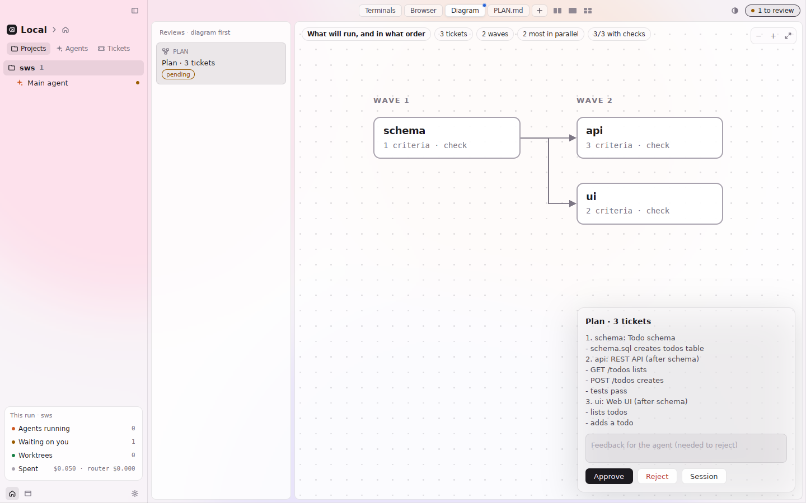
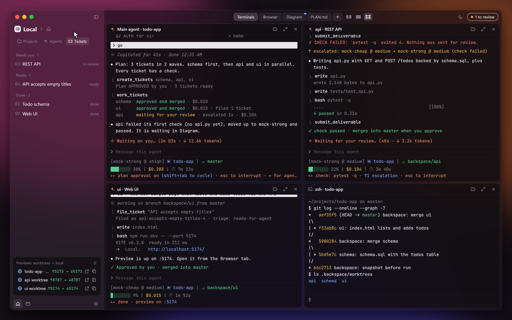
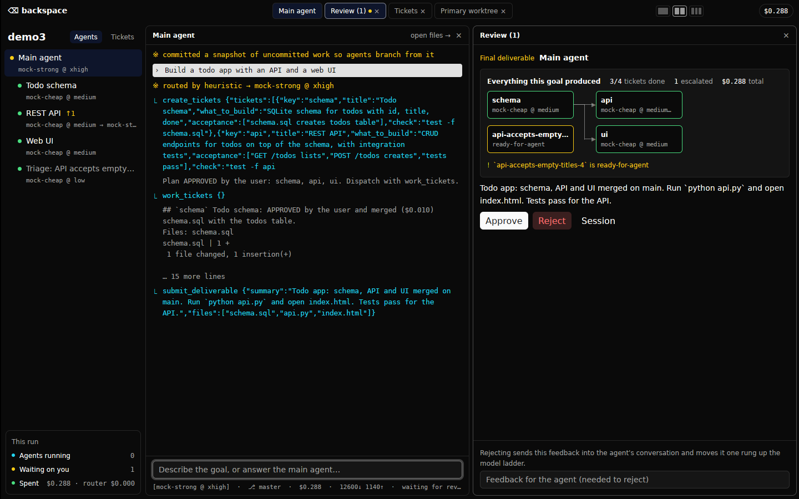
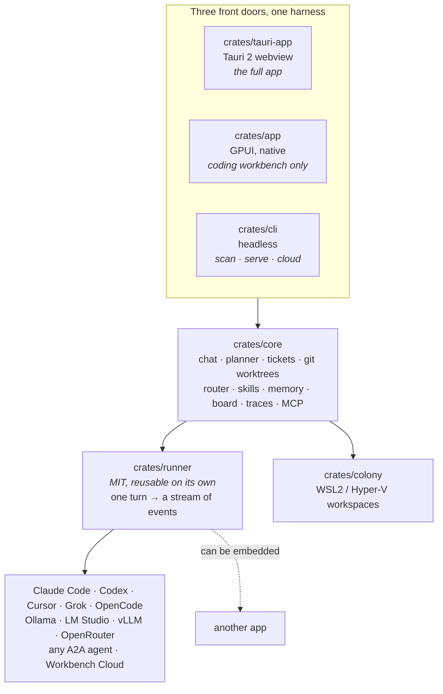

<h1 align="center">Workbench</h1>

<p align="center"><b>Say what you want built. A team of AI agents plans it, builds it in parallel,<br/>checks its own work, and hands you a diff to approve.</b></p>

<p align="center">
  <a href="https://github.com/chamsco/Workbench/releases/tag/mac-latest"></a>
  
  
  
</p>

<p align="center"></p>

<p align="center">
  <a href="#quick-start">Quick start</a> ·
  <a href="#what-is-workbench">What it is</a> ·
  <a href="#the-app">The app</a> ·
  <a href="#what-it-can-do">Features</a> ·
  <a href="#architecture">Architecture</a> ·
  <a href="#known-limits">Known limits</a> ·
  <a href="#glossary">Glossary</a>
</p>

> **A note on the name.** The project was called *backspace* (and for a while
> *ohMyHarness*), and that name is still baked into the code: the crates are
> `backspace-*`, the commands are `backspace-cli`, the config folder is
> `~/.config/backspace`. **Workbench is the product; `backspace` is the
> plumbing.** They are the same thing.

---

## What is Workbench?

Workbench is a desktop app that turns **a sentence into working code, using
several AI agents at once.**

You point it at a folder and type what you want — *"users should be able to sign
up and log in"*. It asks you a few numbered questions to pin down what you
actually mean. Then it writes a plan made of small tickets. You approve the plan,
and it starts one agent per ticket. Each agent gets its own branch and its own
copy of the repo, so three agents working at the same time cannot overwrite each
other. When an agent says it is finished, a check runs. If the check fails, the
work goes straight back to that agent — nobody reviews broken work. Only work
that passed reaches you, as a diff you can read.

**You make two decisions in the entire loop: approving the plan, and approving
the diff.** Everything between those two moments is automatic.

### Why not just use a chat window?

The model is the easy part. You can plug in whichever one you already pay for.
What is missing from a plain chat is everything *around* the model:

| A chat gives you | Workbench adds |
|---|---|
| One conversation at a time | Several agents working at once, isolated from each other |
| Code pasted into a reply | Real branches, real worktrees, real merges into your repo |
| "I've finished" | A command that runs and must pass before you are asked to look |
| A wall of text | A diff, a per-file line count, and a diagram of what ran |
| Trust that it read the right files | A trace of every tool call, with tokens and cost |
| Nothing, tomorrow | Persistent memory, resumable work, and a record of every route taken |

It is a **workshop around your models**, not another chatbot.

<p align="center"></p>

<p align="center"><em>The design both desktop shells reproduce: four agents at once, plus your own shell, in one window.</em></p>

## See it move

<p align="center"></p>

<p align="center"><em>The shell, the ticket list, the diagram-first review, and the plan — in eight seconds.</em></p>

## Quick start

**Option A — install the Mac app.** Download the `.dmg` from
[the latest build](https://github.com/chamsco/Workbench/releases/tag/mac-latest)
(Apple Silicon and Intel in one bundle). It is **unsigned**, so the first launch
needs right-click → Open, or:

```sh
xattr -dr com.apple.quarantine /Applications/Backspace.app
```

**Option B — build from source.** Needs Rust ≥ 1.98 (the GUI stack uses APIs
that 1.94 rejects). On Linux also install
`libxkbcommon-dev libxkbcommon-x11-dev libwayland-dev libvulkan-dev libfontconfig-dev`.

```sh
export ANTHROPIC_API_KEY=...      # and/or OPENROUTER_API_KEY
export TYPESAFE_API_KEY=...       # optional: smart model routing (see below)

cargo run --release -p backspace-tauri -- ~/projects/my-app   # desktop app (recommended)
cargo run --release -p backspace -- ~/projects/my-app         # desktop app (GPUI, lighter)
cargo run --release -p backspace-cli -- ~/projects/my-app "build me a todo app"
cargo run --release -p backspace-cli -- scan                  # what CLIs/models did it find?
```

**Then, in the app:** run setup (skippable), open a project folder, and type a
goal. Something like:

> *"The API accepts todos with an empty title and stores them. Make an empty
> title a 400, and add a test that proves it."*

It will ask you a few questions, then show you a plan. Approve it.

To run the tests: `cargo test` (core plus end-to-end against a mock model — no
network, no keys).

<details>
<summary><b>What first run walks you through</b></summary>

Setup is skippable, and "Run setup again" is in Settings. In order:

1. **Which apps to start with** — Chat, Code, or both. At least one; either can
   be added or removed later under Apps → Built in.
2. **A scan of the coding CLIs on this machine** — Codex, Claude, Cursor, Grok,
   OpenCode, Antigravity: version, signed in or not, and the plan where the CLI
   will say. One switch per CLI. `backspace-cli scan` prints the same thing from
   the terminal.
3. **Your first agent** (see *Bring your own agent* below).
4. **Ollama and any OpenAI-compatible routers.**
5. **An optional Cloud plan.**

A CLI that is installed but signed out gets a sign-in button (Sign in with
ChatGPT for Codex, Claude Code, Cursor, OpenCode) that opens the CLI's own login
in a terminal. Workbench never sees the credentials. What each provider actually
allows is in [`docs/AUDIT.md`](docs/AUDIT.md).

</details>

## How a project runs

The same five steps as the diagram at the top, with the details:

1. **It interviews you.** Your first message is the goal. The main agent asks
   numbered questions, each with its own recommended answer, so replying *"go"*
   accepts them all. Turn it off with `workflow.grill = false`.
2. **It plans in tickets.** It writes `PLAN.md`, then splits the goal into
   vertical slices with acceptance criteria, `blocked_by` edges between them,
   and — ideally — a `check` command each. **You approve the plan before any
   work starts.** A rejected plan is thrown away and redone.
3. **It dispatches.** One agent starts per ticket, in parallel, respecting the
   blocking edges.
4. **It isolates.** Every ticket agent gets its own branch (`backspace/<key>`)
   and its own git worktree under `.backspace/worktrees/<key>`, forked from its
   parent's branch *after* its blockers were merged — so it builds on their work
   instead of fighting it.
5. **It gates.** When the agent submits, the harness commits the worktree and
   runs the ticket's `check`. A failure bounces straight back to the agent.
6. **You review, then it merges.** Each top-level ticket comes to you with its
   `git diff --stat`. Approve, or reject with feedback (feedback goes back into
   the agent's conversation). Accepted work merges into the parent's branch; a
   merge conflict is handed back to the agent with the exact `git merge` to run.
7. **It verifies the whole thing** and submits the final deliverable.

**Every review starts with a diagram the harness draws from its own data** —
never one the agent drew:

<p align="center"></p>

- **Plan** — the ticket graph in waves, how many run in parallel, which tickets
  have no check.
- **Ticket** — what it was blocked by, the model path including any escalations,
  the check that passed, where it merges, and exact per-file line counts.
- **Final** — every ticket with its state and route, plus anything left open.

<p align="center"></p>

<p align="center"><em>The real review, light mode. The plan, its waves, and which tickets have checks — drawn from the harness's own data.</em></p>

### Start cheap, escalate on evidence

Routing picks a *starting point*, not a verdict. An agent climbs one rung — more
effort first, then the cheapest stronger model — **only** when something is
actually wrong:

- its ticket's check failed,
- a reviewer rejected it or sent it back with `revise_ticket`,
- it made the same tool call over and over (`loop_repeats`),
- it ran out of turn budget.

At most `max_steps` rungs up, capped at `escalation.start_max_effort`. Every
finished ticket appends its route, escalations, cost and outcome to
`.backspace/outcomes.jsonl` — the data to learn routing from later, instead of
guessing from briefs.

### Nested teams (after Paperclip)

- Agents above `max_depth` (default 2) can create and dispatch their own
  sub-tickets: main → leads → their reports. Sub-branches fork from and merge
  into the lead's branch.
- **Review follows the org chart.** Tickets at depth ≤ `human_review_depth`
  (default 1) come to you; deeper ones go to the agent that planned them, which
  verifies in its own worktree and can reopen one with `revise_ticket`.
- **Goal ancestry.** Every brief carries the chain of goals up to the project goal.
- **Budgets.** `budget_usd` on a ticket caps that agent *and its subtree*;
  `max_project_usd` caps the project.

### Tickets and triage

Tickets are mirrored to `.backspace/tickets/NN-key.md` and move through
`proposed → ready-for-agent → queued → in-progress → in-review → done`, plus
`needs-triage`, `needs-info`, `ready-for-human`, `failed`, `wontfix`.

Agents call `file_ticket` for anything outside their scope instead of quietly
fixing it; you can file one from the Tickets view. Tickets also open in a drawer
from the review pill in the sidebar — hover it a moment, or click to pin it. You
can file there, and open one for its details; "Check for updates" sits just below.

<p align="center"></p>

A **triage agent** (read-only, forced to `low` effort) verifies the claim,
checks for duplicates, and classifies it. Ready ones appear in the owner's next
`work_tickets` report.

## The app

Two shells draw the same interface over the same in-process harness. Pick after
reading [the benchmark](bench/README.md):

- **`backspace` (GPUI)** — native, starts about 5× faster, uses less memory. It
  has no web engine, so a browser canvas shows a text snapshot and opens the
  page in your real browser.
- **`backspace-tauri` (Tauri 2)** — HTML/CSS/JS in the system webview, with live
  dev-server previews *inside* the app. This is the fuller shell.

<p align="center"></p>

<p align="center"><em>The real shell mid-run. This session was driven by a mock model, so the model names and ticket text are placeholders — the layout is the app.</em></p>

### Zones

A rail of squares on the far left (Slack-style) switches zones: **Chat**,
**Code**, **Memory**, **Apps**, then anything you pinned from the app catalog,
with **Settings** at the foot. Each zone keeps its state while another is shown.
The split button in the title bar opens a second zone or app beside the current
one. The title bar follows your OS — macOS keeps its traffic lights; Windows and
Linux get their own caption buttons.

### Canvases

**Tabs** sit on the left of the title bar. Each holds one to four **canvases**,
and a canvas shows one thing: an agent session, a worktree, a browser, the
diagram review, `PLAN.md`, visual options, a conversation, or a **terminal** —
a real shell (ConPTY on Windows, `forkpty` elsewhere) started in the open
project's folder, so a build, a git command or a REPL runs where the work is.

`+` opens a tab with a name and a layout (1, 2, 3, 2×2, 1 over 2, 2 over 1,
1 | 2); an unnamed tab shows its actual arrangement. Drag a tab to reorder it;
right-click or double-click to rename, duplicate or close it.

Drag a canvas by its header to rearrange: a dotted `+` slot shows where it will
land, other canvases slide out of the way, dropping on the middle of another
canvas swaps them, and dropping on an edge splits it. Drop it on a tab to move
it there. `Esc` cancels. The arrangement is a split tree saved per tab.

Press **Ctrl ↵** on Home to start another task in parallel, on its own branch.

### Settings

The gear covers providers, the Cloud plan, which harness runs workers, accounts,
local tiny models, skills, worktrees, Colony workspaces, API keys, projects,
what the app is used for, appearance (accent, colours, fonts, contrast),
machines, sharing this machine, and update checks. The panel is a grouped left
nav — **Personal**, **Integrations**, **Coding**, **System** — with one section
at a time beside it.

### Status, machines and sharing

The status bar shows the branch, the project and its ticket count, who is
working, the split, the phone link, a motion toggle (Full or Reduced), and the
tokens and cost so far.

**Machines** switch from the sidebar foot — your laptop, or a machine you
follow. To follow one, run the harness headless somewhere and share it:

```sh
BACKSPACE_TOKEN=... backspace-cli serve ~/projects/my-app 127.0.0.1:7420
```

Add it from Settings → Machines with its address and token and you can see its
agents, tickets and reviews live, and approve from your machine. The API is plain
HTTP with a bearer token, so keep it on localhost behind an SSH tunnel
(`ssh -L 7420:127.0.0.1:7420 box`) or on a private network such as Tailscale.

## What it can do

<details open>
<summary><b>Code — pair with one agent, or run a workbench of them</b></summary>

**Pair** is you and one coding CLI, turn by turn, in the open project. The CLI
runs in the project folder with leave to edit files and run commands (Claude Code
with `acceptEdits`, Codex `--full-auto`, Cursor `--force`).

**Workbench** is the planner-and-workers loop described above. Its title bar
switches between **Canvases** (tabs of split canvases), **Wall** (every agent's
live session tiled, however many there are), and **Inbox** (what needs you, then
what is running, then what is done).

Workers run on the router's pick or, when Settings → Coding names one, on a
coding CLI inside the ticket's worktree. The planner still needs an API model
(Anthropic or OpenRouter key).

</details>

<details>
<summary><b>Chat — threads that answer from any model or CLI</b></summary>

**Chat** (Tauri shell) is a port of [Whirl](https://github.com/whirlchat/whirl)'s
React chat face (MIT), frosted over the window. A thread answers from one of:

- a coding CLI you are signed in to, headless, on your own subscription
  (Claude resumes its session between turns);
- a model in Ollama, or any router (OpenRouter, LM Studio, vLLM, LiteLLM);
- **Workbench Cloud**: Free (50 replies a day, small models, one sponsored card
  under each reply), Plus ($8/month: 1,500 replies without ads on small and
  standard models, then small models with ads), or Max ($30/month: 5,000
  replies, every model, then ads or pay as you go). Ads are a separate card,
  never inside an answer, and are never chosen from what you type. Nothing is
  billed yet.

The composer switches the model per thread, attaches files, and `@codex` (or any
CLI id) sends one reply to another CLI. Threads can be retried, edited, branched,
pinned and renamed. Messages take a tapback (the six iMessage ones), can be
answered specifically (the model sees the quote), show a preview card for their
first link, and can be saved to Memory.

**Chat** has two views, switched at the top of its sidebar: **Chat** (the threads
above) and **Agents**:

- An **agent** has a name, a job (its brief), an avatar, a model, its own folder
  (`<data>/agents/<id>/workspace`) and any folders you share with it. A 1:1 chat
  with an agent runs a coding CLI in that folder with leave to edit it, using the
  agent's brief and its own memory as the system prompt.
- A **group** has members and a goal. Each message gets sequential turns: the
  members you name (`@Kira`) first, otherwise everyone in order. A member with
  nothing to add says `PASS` and leaves no message; one that names another hands
  it the turn (at most 8 turns per message).
- **Computer use.** An agent can have a computer — a plain folder, a Docker
  container `backspace-agent-<id>` with its home mounted, or a VPS over SSH —
  reached through the `computer_run`, `computer_read` and `computer_write` tools.
  With "desktop" on, the container runs a web desktop beside the chat.

</details>

<details>
<summary><b>Agents talking to each other</b></summary>

A per-project message board. API agents get `list_agents`, `send_message`, `dm`,
`read_messages` and `read_conversation`; CLI workers get the same through an MCP
server (`backspace mcp`) or the shell (`backspace msg agents|send|read|conversation`),
both reaching a token-protected bridge on `127.0.0.1`. Address an agent by its
key or its ticket's key. A message can answer another (`reply_to`), and
everything two agents say to each other lands in one conversation. The board is
the "Team chat" canvas; each pair's thread is the **Conversation** canvas.

</details>

<details>
<summary><b>Bring your own agent</b></summary>

Workbench hosts agents rather than being one. Setup's "Your first agent" step
(and Chat → Agents, Settings → Coding) offers:

| Pick | How it connects |
|---|---|
| Workbench sidekick | Made here: a name, a job, and any CLI or model you have |
| Claude Code, OpenAI Codex | The CLI on this machine, on your own subscription |
| Grok, Meta Muse | xAI's and Meta's OpenAI-compatible APIs with your key (`api.x.ai/v1`, `api.meta.ai/v1`), added as routers |
| Any A2A agent | Paste the address of its agent card; Workbench sends `message/send`, keeps its `contextId`, waits on its tasks |

Every one becomes a named agent: its own folder, its own memory (off by default
for remote agents, whose notes would leave the machine), a seat in groups, traces
and Carry on. OpenAI Dots and Grok Bot are consumer apps with no outside API to
drive them, so they are not offered.

All of it runs through [`crates/runner`](crates/runner): build a `Request`, get
`Event`s (text, tool calls, session, tokens, cost). It knows nothing about chats,
so another app can depend on it.

</details>

<details>
<summary><b>Which model runs this? (Jev, the router, and tiny local models)</b></summary>

Each agent is routed separately. [Jev](https://typesafe.ai) (TypeSafe's System One
decision model, about $0.04/M tokens) picks **which model** and **what effort
level** (`low → medium → high → xhigh → max → ultra`) fit that agent's brief.
Without a Jev key a keyword heuristic stands in. Either way the pick is only a
starting point — agents start cheap and climb on evidence of failure.

You can also keep a plan on high, delegate on medium, and hold a strong model in
reserve:

- **A strong model leads.** The main agent is pinned to Sonnet at high effort when
  an Anthropic key is set; otherwise the router or a CLI takes the lead.
- **A stronger one advises.** Agents on the Anthropic API get the server-side
  `advisor` tool, consulted before a plan locks, when the same check fails twice,
  and before work is called done — never on routine steps.
- **Small fast ones scout.** A `scout` tool sends up to three small, read-only
  agents in parallel to find files and read code or docs.

**Small local models do the small jobs.** Settings → Local models finds Ollama,
LM Studio, llama.cpp and MLX (plus any loopback OpenAI endpoint), lists what each
has, marks the ≤ 4B ones as tiny, and suggests what to hand a small job to. Then
choose which jobs it runs: **scouts** (read-only lookups, the safe default),
**triage**, and **workers** (only if the model is up for it). Those jobs go to it
*first* and fail loudly if the runtime is down rather than quietly spending
money. `backspace-cli models` prints the same. Nothing is pulled or downloaded
for you.

**Several accounts per CLI, with failover.** Settings → Accounts keeps one
profile directory per login, pointed at the CLI's own variable
(`CLAUDE_CONFIG_DIR`, `CODEX_HOME`, `GEMINI_CLI_HOME`, `COPILOT_HOME`,
`CURSOR_CONFIG_DIR`, `XDG_DATA_HOME`), and tracks health per login. On
**Automatic**, when a CLI reports a *confirmed* usage limit, that login is parked
and the next turn runs as the next healthy one — never on a plain rate limit.
Workbench never holds the credential: each login signs in to its own profile
directory.

</details>

<details>
<summary><b>Memory — notes that survive, learn, and tidy themselves</b></summary>

Short notes every chat and agent gets (*"use pnpm, never npm"*): global, tied to
one project, or kept by one agent. Chats get the global notes plus their
project's (or their agent's), ranked by importance, use and age, as part of the
system prompt. Add them in the Memory zone, or with **Remember** on any message.
One switch turns them off without deleting them.

**Stored as an [Agent Memory Repo](https://github.com/AgentMemoryRepo/agentmemoryrepo):**
a git repo of Markdown in `<data>/memory`, one commit per change.

```text
memory/
  MEMORY.md                  # global notes, then ## Index linking the rest
  projects/<name>-<hash>.md  # "# Project: /abs/path"
  agents/<id>.md             # "# Agent: <id>"
```

Each note is a bullet with metadata:
`- The user prefers short answers [id: …; added: 2026-10-06; kind: preference; source: backspace://thread/…]`

You — or Claude Code, Devin, any agent with the AMR skill — can edit those files
by hand. Workbench picks up the change, keeps bullets and index lines it did not
write, and leaves other files alone. Add a private remote yourself to sync across
machines.

**Agents read and write it themselves** through `memory_search` and
`memory_save`. Saves that look like credentials are refused.

**It notices things on its own** ("from now on…", "remember that…", "I prefer…").
A small logistic model on this machine scores each message, with no network call;
above its threshold the note is saved in the third person and a toast says who
will remember it. "Don't remember that" deletes it, trains the model away from
it, and is itself remembered — so the same thing is never noticed again.

**It can tidy itself ("dreaming"), off by default.** About once a day, when you
have said enough since last time and no chat is busy, your default chat model
reads what you said next to what memory holds, and in one commit merges
duplicates, rewrites or removes notes that are out of date or contradicted, and
adds what you made clear but nothing caught (at most 8, each citing its chat).
Notes *you* wrote are never deleted by a tidy, only turned off. Memory → Tidy now
runs it on demand; Tidy history lists every change with its reason and an Undo
(a `git revert`).

</details>

<details>
<summary><b>Traces and Carry on</b></summary>

Every reply is a **trace** and every tool call a **span** (OpenTelemetry shape,
GenAI attribute names), kept in `<data>/traces/`. The timeline button under a
reply shows the waterfall with each tool's input and output, the model, tokens
and cost. Settings → Tracing sends traces to any OTLP/HTTP collector (treg,
Jaeger, Langfuse…), without prompts or output unless you allow it.

**Carry on** resumes a reply that was cut off by quitting or by Stop. What was
written is saved before and after each tool call, and Carry on picks it up on
Claude Code's own session — or from the conversation plus the partial answer for
everything else. The agent is told to check what is already done instead of
redoing it.

**Workbench workers carry on too.** Closing the app mid-ticket no longer throws
the agent away. The project reopens with the worker marked **interrupted** — not
failed, because nothing about the work failed — and Inbox → *Needs you* offers
**Carry on**. Its worktree and branch are already on disk and a CLI worker
answers again *in its saved session*, so it continues where it stopped and the
result still goes through the same check, review and merge. A worker that
genuinely failed, or one still running, is refused: this is not a retry button.

</details>

<details>
<summary><b>Visual options, apps and the phone link</b></summary>

**Visual options.** `show_options` puts two to six variants of a design, a layout
or a change on screen — each an image the agent wrote, or a live page — and waits.
The Options canvas draws them as a row of thumbnails with a Choose pill and the
agent's note; a Compare switch opens two side by side with a draggable split. Your
pick comes back to the agent as that tool's result.

**Apps.** Views with their own agent that anyone can make: a folder with a
`backspace-app.json` and a page. Install from a link to the manifest or from a
folder; open from Apps, pin to the rail, or put one beside a chat. The page runs
sandboxed and talks to Workbench through `apps/sdk.js` — ask models the user has
on (`backspace.agent.ask`), keep data, notify. Apps can also give coding CLIs
tools through `backspace mcp`. Format and security model:
[`docs/apps.md`](docs/apps.md). Example:
[`apps/prompt-lab`](apps/prompt-lab), which asks two models the same prompt.

**Phone.** Settings → Phone opens a token-protected API to pair a phone app
(**not built yet**): chats, tapbacks, Memory, and a project's approvals. It binds
**loopback** unless you turn on *Reachable from my network*, and the phone only
ever sees your own chats — app, agent and group threads are refused, because
those run a CLI with leave to edit a folder. Protocol and plan:
[`docs/companion.md`](docs/companion.md).

</details>

<details>
<summary><b>Colony — a machine of its own for an agent</b></summary>

Colony gives an agent a durable, chat-addressable workspace: a WSL2 distro or a
Hyper-V VM created on demand, used through `colony_create` / `colony_exec` /
`colony_list` / `colony_status` / `colony_destroy`, and destroyed when the task is
done. It drives the `visor-core` JSON CLI in [`capsule/`](capsule); without it
those tools are simply not offered. Design, the landscape it borrows from, and
what is not tested: [`docs/COLONY.md`](docs/COLONY.md) and
[`docs/DURABLE-OBJECTS-2026-10.md`](docs/DURABLE-OBJECTS-2026-10.md).

</details>

<details>
<summary><b>Skills — the instructions agents work to</b></summary>

A skill is a folder with a `SKILL.md` in it. The frontmatter's `description` is
what the agent's index shows; the body is what it reads once it decides the skill
fits. Vendored from [mattpocock/skills](https://github.com/mattpocock/skills)
(MIT): `grilling`, `to-tickets`, `triage`, `tdd`, `diagnosing-bugs`,
`code-review`. Also vendored, from
[DietrichGebert/ponytail](https://github.com/DietrichGebert/ponytail) (MIT):
`ponytail` — "the lazy senior dev": the smallest change that fully solves the
task, one test for anything non-trivial, and a note on what was skipped. It is
injected into implementation workers by default (`workflow.worker_skills`).

Each role gets some injected (`workflow.*_skills`); every agent can load any of
them with the `skill` tool. Drop a folder with a `SKILL.md` into
`~/.config/backspace/skills/` or `<workspace>/.backspace/skills/` to override one
or add your own. The files are kept verbatim; a short adapter note maps their
vocabulary onto Workbench's tools. Full story:
[`docs/SKILLS.md`](docs/SKILLS.md).

</details>

## Architecture



| Path | What lives there |
|---|---|
| `crates/runner` | One turn on any CLI, Ollama, OpenAI-compatible API or A2A agent (MIT, reusable) |
| `crates/core` | The harness: router, providers, tools, tickets, git worktrees, skills, accounts, local models |
| `crates/colony` | Durable, chat-addressable workspaces (WSL2 / Hyper-V) as `colony_*` tools |
| `crates/cli` | Headless shell — logs to stdout, approvals on stdin |
| `crates/app` | Desktop shell, GPUI (native) |
| `crates/tauri-app` | Desktop shell, Tauri 2 (the design's HTML in the system webview) |
| `capsule/` | Colony's hypervisor core: `visor-core` (Rust JSON CLI) + `agentd` (Go, `:7700`) |
| `apps/` | App SDK (`sdk.js`) and the Prompt Lab example app |
| `design/` | `workbench.html` — the clickable design both shells reproduce |
| `bench/` | GPUI vs Tauri benchmark ([bench/README.md](bench/README.md)) |

For a zoomable map of the whole flow with the code location of every step, open
[`docs/architecture.html`](docs/architecture.html) in a browser. Or open
[`design/workbench.html`](design/workbench.html) for a single-file, clickable
replica of the desktop app: frosted macOS window, environment tabs (terminals up
to 2×2, live worktree previews, diagram review, `PLAN.md`), resizable splits,
light and dark. It is the original static mock, and the shells have moved past
it — they add tabs of canvases, machines and settings — but everything you see
in the mock is reachable in the real thing.

### Where your files live

```text
~/.config/backspace/prefs.json     tabs, theme, machines      (BACKSPACE_PREFS overrides)
<data>/memory/                     the memory git repo
<data>/traces/                     one trace per reply
<data>/agents/<id>/workspace/      an agent's own folder
<workspace>/.backspace/state.json  the record of a run
<workspace>/.backspace/tickets/    tickets as Markdown
<workspace>/.backspace/worktrees/  one worktree per agent
```

`BACKSPACE_DATA` overrides the data directory. `.backspace/` ignores itself in
git.

### Principles (after Pi)

- **Four tools:** `read`, `write`, `edit`, `bash`. Everything else goes through
  bash.
- **Config is the product:** one TOML file, no hidden merging — models, prices,
  descriptions (what Jev reads to choose), providers, caps.
  `backspace-cli init-config` writes the default to `./backspace.toml`.
- **`AGENTS.md`** in the workspace is appended to every agent's system prompt.
- **Two wire formats** cover most models: Anthropic Messages and OpenAI-compatible
  Chat Completions (OpenRouter, Ollama, vLLM, …).

## Glossary

| Word | What it means here |
|---|---|
| **Agent** | One model or CLI with a brief, a folder, and a job. Agents are cheap; you run several. |
| **Ticket** | One small, reviewable piece of the goal, with acceptance criteria and usually a `check`. |
| **Blocked by** | Ticket B cannot start until ticket A is merged, because B builds on A's code. |
| **Check** | A command (`test -f api.py`, `pytest -q`) that must pass before a human looks at the work. |
| **Worktree** | A second copy of your repo on disk, on its own branch, so two agents never share files. |
| **Canvas** | One pane in the window: an agent session, a browser, a terminal, the review, `PLAN.md`. |
| **Zone** | A top-level area of the app (Chat, Code, Memory, Apps), switched from the left rail. |
| **The board** | The per-project message board agents use to talk to each other. |
| **Router / Jev** | The thing that decides which model and how much effort a given agent's job deserves. |
| **Escalation** | Moving an agent one rung up (more effort, or a stronger model) after real evidence of failure. |
| **Harness** | The machinery around the model: tools, isolation, checks, review, memory. |

## Known limits

We would rather you knew these before you trusted it.

- **No sandbox.** `bash` runs as you, in the workspace. The file tools refuse
  paths outside it; bash does not. Run it in a container or VM for untrusted goals.
- **Not resumable across the board.** Closing the app ends in-flight agents.
  `state.json` is a log, not a checkpoint. (Workbench workers are the exception —
  see Carry on.)
- **Non-streaming requests.** A long single turn shows up only when it finishes.
- **The workspace must be a git repo** (one is created if not). Uncommitted work
  is committed as `backspace: snapshot before run` so agents can branch from it,
  and agents' work merges onto the branch you have checked out. Use
  `isolation = "shared"` to skip git entirely.
- **Worktrees are kept after the run** (so you can reopen tickets). Each has its
  own copy of dependencies (`node_modules`, `target/`), which costs disk.
- **Merge conflicts are handed back to the agent**, but that path is only covered
  by the git unit test, not the end-to-end tests.
- **The heuristic router is crude by design.** Routing quality comes from Jev.
- **Chat, setup, Cloud, Memory, Apps, the rail and the phone link exist only in
  the Tauri shell.** The GPUI shell has the coding workbench only.
- **The phone app does not exist yet.** Only its link and API do. The link is
  plain HTTP on the LAN with a token — use Tailscale away from home.
- **App tools run as you**, like any program you install.
- **The headless flags for Codex, Cursor, Grok, OpenCode and Antigravity** follow
  their docs but were only exercised against Claude Code.
- **Group turns run one after another**, so a group of four is about four times as
  slow as a 1:1 chat.
- **Agent computers were tested with Docker (alpine).** The web desktop image
  (~1.5 GB) and the SSH/VPS path are untested. A Docker computer is not a security
  boundary against a determined agent.
- **The memory scorer starts from hand-set weights** and learns only from your
  "Don't remember that" and confirmations; expect misses early.
- **A tidy sends your recent messages from every chat to your default chat model
  in one prompt**, which is why the daily tidy is off by default.
- **Memory's git repo has no remote by default**; syncing it between machines is
  up to you (`git remote add` a private repo).
- **Tracing to treg is untested** — its docs could not be reached from the build
  machine. It is sent as standard OTLP/HTTP JSON.
- **A2A:** `message/send` with polling only. Streaming (`message/stream`), push
  notifications and file parts are not used yet. Tested against a local agent.
- **Colony:** the registry, tool wiring and account/local-model paths are tested
  without a VM, but `visor-core` itself has only been exercised by hand.
  Hyper-V needs an elevated host; `colony_exec` is WSL only; snapshots, GC and a
  guest agent are not built. See [`docs/COLONY.md`](docs/COLONY.md).
- **The terminal canvas is a PTY, not an emulator.** It draws plain text, so
  full-screen TUIs are not the point. On a locked-down Windows host ConPTY can
  open without ever producing output; the canvas says so instead of sitting blank.
- **Multi-account failover** does not checkpoint and resume a CLI session
  mid-turn, so a turn that dies on a limit is re-asked on the new login.
- **Routing to a local model is a first choice, not a fallback.** If the runtime
  is down, the job fails and says so rather than quietly spending money.
- **Cloud is a development server:** no accounts beyond a local token, no billing.

## Building and contributing

```sh
cargo test                    # core + e2e against a mock model; no network, no keys
cargo test -p backspace-runner
(cd crates/tauri-app/web && npm ci && npm run build)   # after editing the chat face
cargo run --release -p backspace-tauri
cargo run -p backspace-runner --example ask -- claude "hi"
```

**Where to change what:**

| You want to | Start at |
|---|---|
| Add a tool an agent can call | `crates/core/src/tools.rs` |
| Add a model provider | `crates/core/src/provider.rs` (and `crates/runner`) |
| Change an agent's instructions | `crates/core/src/prompts/` |
| Change how routing picks a model | `crates/core/src/router.rs` |
| Add or override a skill | `crates/core/skills/`, or your own folder ([docs/SKILLS.md](docs/SKILLS.md)) |
| Change the canvas layout model | `crates/core/src/layout.rs` |
| Change the UI | `crates/tauri-app/ui/` (and `web/` for the chat face) |
| Change the design both shells follow | `design/workbench.html` |

**The images in this README are generated, not hand-made.** Everything under
[`docs/assets/`](docs/assets) comes from [`tools/doc-assets/`](tools/doc-assets) —
which renders `design/workbench.html` headlessly, drives it through the states
you see, and encodes the loop. See
[tools/doc-assets/README.md](tools/doc-assets/README.md) to regenerate them.

**This is 0.1.x.** Expect breaking changes; there is no stable config format yet.

## Credits

Workbench is assembled from other people's good work: [Whirl](https://github.com/whirlchat/whirl)
(chat face), [mattpocock/skills](https://github.com/mattpocock/skills) and
[DietrichGebert/ponytail](https://github.com/DietrichGebert/ponytail) (agent
skills), [Pi](https://github.com/badlogic/pi-mono) (the four-tool principle),
and the [Agent Memory Repo](https://github.com/AgentMemoryRepo/agentmemoryrepo)
format. [Jev](https://typesafe.ai) does the routing. Third-party notices:
[THIRD_PARTY_NOTICES.md](THIRD_PARTY_NOTICES.md).

MIT licensed — the license is declared in `Cargo.toml` and in every crate's
manifest.
