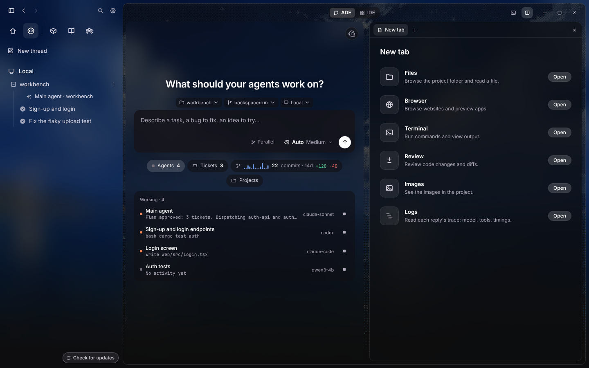
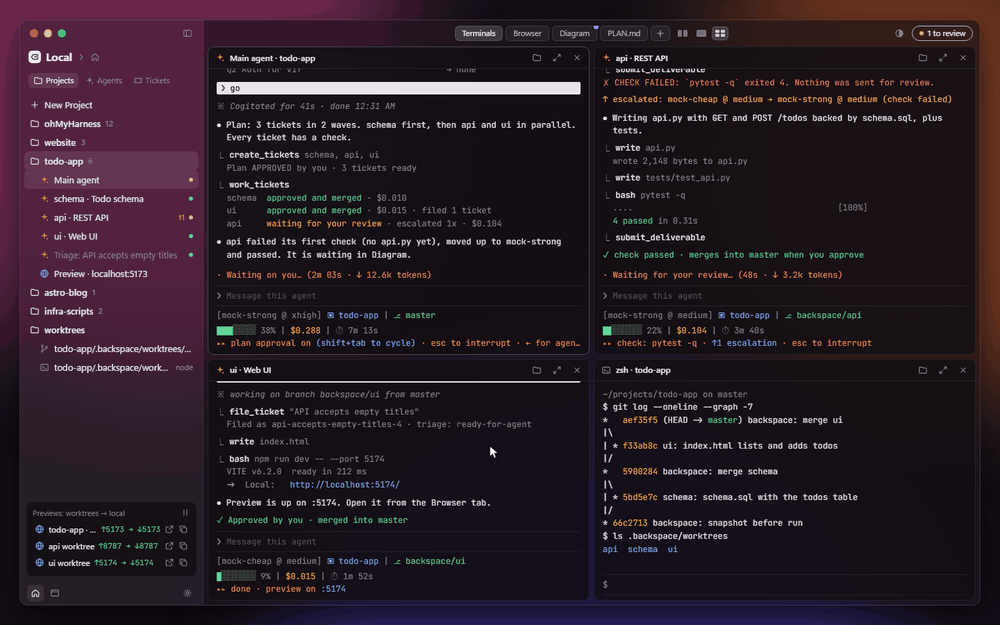
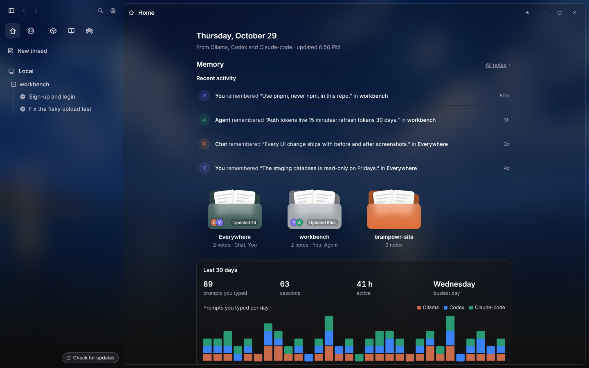
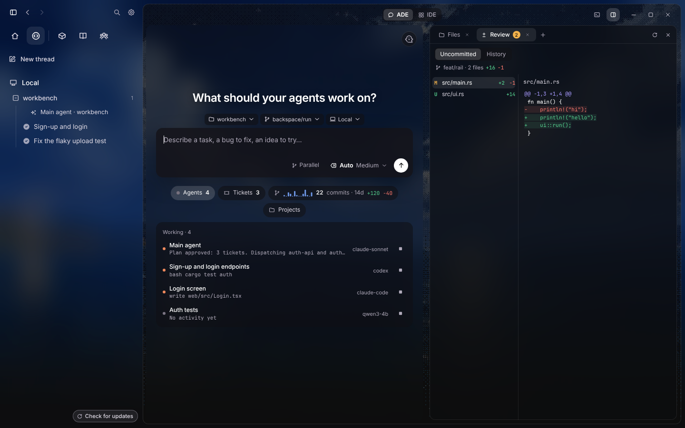

<h1 align="center">Workbench</h1>
<p align="center"><b>A desktop home for your AI agents.</b></p>
<p align="center">Workbench works with the coding CLIs and models you already use. Each agent gets a job and a memory,<br/>several agents can work on a project at once, and you review what they did before anything merges.</p>

<p align="center">
  <a href="https://github.com/chamsco/Workbench/releases/tag/mac-latest"></a>
  <a href="https://github.com/chamsco/Workbench/releases/tag/windows-preview"></a>
  
  
</p>

<p align="center"><sub>
  <a href="#for-humans">For humans</a> ·
  <a href="#for-agents">For agents</a> ·
  <a href="docs/HOW-IT-WORKS.md">How it works, in full</a>
</sub></p>

<p align="center"><a href="docs/assets/app-ade.png"></a></p>

---

## For humans

### What it is

Workbench is one window for your agents.

- **Agents.** Each agent has a name, a brain-shaped face in its own colour, instructions, a model and a folder. You can talk to one directly, put several in a group, or let them run on a schedule.
- **One memory.** Notes outlive a chat. A note can apply everywhere, to one project, or to one agent. Notes are stored as a git repo of Markdown files that you can edit by hand.
- **Apps on top.** **Code** is for building software and **Chat** is for conversations. Each app is a different view of the same agents, memory and projects. Design and Clip Studio are planned.
- **Traces.** Every reply is recorded: each tool call, the tokens and cost, and what filled the context.

Workbench doesn't bring its own model. It finds Claude Code, Codex and other coding CLIs, plus Ollama, LM Studio, OpenAI-compatible routers and A2A agents. It never holds their credentials.

### See it

<p align="center"></p>

### Install

- **macOS:** download the `.dmg` from [mac-latest](https://github.com/chamsco/Workbench/releases/tag/mac-latest). It runs on Apple Silicon and Intel. The build is unsigned, so open it the first time with right-click → Open, or run `xattr -dr com.apple.quarantine /Applications/Backspace.app`.
- **Windows:** download the installer or the portable `.exe` from [windows-preview](https://github.com/chamsco/Workbench/releases/tag/windows-preview). It is also unsigned, so in SmartScreen click More info → Run anyway.
- **From source:** see [Build and test](#build-and-test).

The first launch walks you through a short setup, and you can skip it. You pick the apps you want, the CLIs it found on this machine, your first agent, and any local models or routers.

### Getting around

<table>
<tr>
<td width="50%"><a href="docs/assets/app-home.png"></a></td>
<td width="50%"><a href="docs/assets/app-review.png"></a></td>
</tr>
<tr>
<td><b>Home</b> shows what was remembered, your activity, plan usage, recent threads and projects.</td>
<td><b>The ADE</b> puts the agent chat beside a work area with Files, Browser, Terminal, Review, Images and Logs.</td>
</tr>
</table>

- **Sidebar.** The top row has the sidebar toggle, back and forward, search and settings. Under it are the app icons, then **New thread** (⌘N), then your projects and their threads. When you fold the sidebar, the app icons become a slim pill on the left edge.
- **Code** has two modes. Switch between them at the top centre, or with ⌘J.
  - **ADE** is for talking to the agents. The work area starts on a New tab page, and each view you open becomes a tab.
  - **IDE** is for watching them work: up to six canvases, or the **Wall** with every agent tiled.
- **Settings** opens over the page. Close it with the round button.

### How a task runs

1. You describe the goal. The main agent asks a few questions, each with a suggested answer.
2. It proposes a plan of small tickets, each with a check that proves it is done. **You approve the plan.**
3. One agent starts per ticket, in parallel. Each one works on its own branch and its own copy of the repo.
4. A ticket's check has to pass before you see the work. A failure goes back to that agent.
5. **You review the diff**, and approving it merges it.

Workbench picks a model and an effort level for each ticket, and moves to a stronger model only when there is evidence the job needs one. Details: [How it works](docs/HOW-IT-WORKS.md).

### Good to know

- **There is no sandbox.** Agents run shell commands as you, inside the project folder. Use a container or VM for anything you don't trust.
- **Builds are unsigned and early (0.1).** Expect breaking changes, and there is no stable config format yet.
- **Closing the app stops agents that are running.** Workbench's own workers can pick up where they left off with **Carry on**.
- **Each agent keeps its own copy of the repo,** dependencies included, so disk use grows.
- **The phone app isn't here yet.** Only its pairing API exists.

The full list of limits is at the end of [How it works](docs/HOW-IT-WORKS.md#what-it-doesnt-do).

---

## For agents

Read this section if you are an AI agent working in this repository. It covers where things are, how to build and check your work, and the rules the codebase follows.

### Names

The product is **Workbench**, and that is the only name users should see. In the code it is still **backspace**: the crates are `backspace-*`, the binary is `Backspace` and the config lives in `~/.config/backspace`. **Brainwave** is the name of the redesign project (see [`docs/brainwave/`](docs/brainwave/PLAN.md)). **Brainpowr** is the local model engine and the coding TUI.

### Repo map

| Path | What lives there |
|---|---|
| `crates/tauri-app/ui/` | The desktop shell, in vanilla JS: `app.js` (runtime), `shell.js` (frame), `work.js` (the ADE work area), `dash.js` (Home), `shell.css`, `index.html`, plus `extensions/code` and `extensions/chat` |
| `crates/tauri-app/web/` | The chat face, in React. It builds to `ui/chat-web/whirl.js` |
| `crates/tauri-app/src/` | The Tauri commands the UI calls |
| `crates/core` | The harness: planner, tickets, worktrees, router, tools, memory, traces, and hands (browser and desktop use) |
| `crates/runner` | One turn on any CLI, model API or A2A agent. MIT, and reusable on its own |
| `crates/cli` | The headless shell: `backspace-cli`, plus `backspace mcp` for agents |
| `crates/app` | The older native GPUI shell (only the coding workbench) |
| `tools/uiharness` | Headless Chromium harness for the UI, with mocked commands |
| `docs/` | Design and architecture notes; [`docs/brainwave/`](docs/brainwave/PLAN.md) is the current plan |

### Build and test

```sh
cargo test                                   # core + end-to-end against a mock model; no network, no keys
cargo test -p backspace-runner
cargo run --release -p backspace-tauri -- ~/projects/my-app
(cd crates/tauri-app/web && npm ci && npm run build)   # after editing the chat face
```

You need Rust 1.98 or newer. On Linux, `cargo check -p backspace-tauri` also needs `libgtk-3-dev libwebkit2gtk-4.1-dev libsoup-3.0-dev`.

To check UI changes without a desktop, use the harness. It serves `ui/`, stubs every Tauri command and takes screenshots:

```sh
node tools/uiharness/run.mjs --shot-mode viewport --eval-file tools/uiharness/evals/ade-work.js --shot out.png
```

Inside an eval, mock commands with `__H.mock(cmd, fn)`, then call `__H.fire("state")`. The evals in `tools/uiharness/evals/` are the interaction ledger in [`docs/SHELL-AUDIT.md`](docs/SHELL-AUDIT.md).

### Rules of this repo

- **Don't run `cargo fmt` on whole crates.** The repo isn't rustfmt-clean, so format only the lines you touch.
- **A Tauri command that touches disk, processes or the network must be `async`.** A synchronous command runs on the UI thread and freezes the window.
- **Every UI change gets before and after screenshots** in its PR. Take them with the harness.
- **Add a dated entry at the top of [`HANDOFF.md`](HANDOFF.md)** for each session's change.
- **Only append to `PRESETS` in `crates/core/src/layout.rs`.** GPUI looks presets up by position, so inserting or reordering breaks it.
- **If you change the chat face, rebuild it** and commit `ui/chat-web/whirl.js` and `whirl.css`.
- **macOS-only and Windows-only code is compiled only in CI** (`.github/workflows/macos.yml` and `windows.yml`), so keep it small and well guarded.
- **Don't delete working features when you move them.** Move them and keep them working.

### Where to change things

| You want to | Start at |
|---|---|
| Add a tool an agent can call | `crates/core/src/tools.rs` |
| Add a model provider | `crates/core/src/provider.rs` and `crates/runner` |
| Change an agent's instructions | `crates/core/src/prompts/` |
| Change how routing picks a model | `crates/core/src/router.rs` |
| Add or override a skill | `crates/core/skills/`, or `~/.config/backspace/skills/` |
| Change the canvas layout model | `crates/core/src/layout.rs` |
| Change the window, sidebar or work area | `crates/tauri-app/ui/` (`shell.js`, `work.js`, `shell.css`) |

### Inside a running Workbench

If Workbench runs you as one of its agents:

- `AGENTS.md` in the workspace is appended to your system prompt.
- `backspace mcp`, or the `backspace msg` shell command, reaches the project's message board and the other agents.
- Call `file_ticket` for work outside your ticket instead of doing it quietly.
- Your work reaches a human only after your ticket's check passes.

Your files on disk:

```text
~/.config/backspace/prefs.json     tabs, theme, machines      (BACKSPACE_PREFS overrides)
<data>/memory/                     the memory git repo
<data>/traces/                     one trace per reply
<workspace>/.backspace/tickets/    tickets as Markdown
<workspace>/.backspace/worktrees/  one worktree per agent
```

---

## Credits

Workbench is built on other people's work:

- [Whirl](https://github.com/whirlchat/whirl): the chat face.
- [mattpocock/skills](https://github.com/mattpocock/skills) and [DietrichGebert/ponytail](https://github.com/DietrichGebert/ponytail): agent skills.
- [Pi](https://github.com/badlogic/pi-mono): the four-tool principle.
- [Agent Memory Repo](https://github.com/AgentMemoryRepo/agentmemoryrepo): the memory format.
- [Pele](https://pele.run): diagrams.
- [Jev](https://typesafe.ai): routing.

Third-party notices are in [THIRD_PARTY_NOTICES.md](THIRD_PARTY_NOTICES.md). Workbench is MIT licensed.

<p align="center"><sub>
<a href="docs/HOW-IT-WORKS.md">How it works</a> ·
<a href="docs/brainwave/PLAN.md">The Brainwave plan</a> ·
<a href="docs/architecture.html">Architecture</a> ·
<a href="docs/AUDIT.md">What each provider allows</a> ·
<a href="docs/LOCAL-MODELS.md">Local models</a> ·
<a href="docs/SKILLS.md">Skills</a> ·
<a href="docs/apps.md">Apps</a> ·
<a href="tools/doc-assets/README.md">How these images are made</a>
</sub></p>
