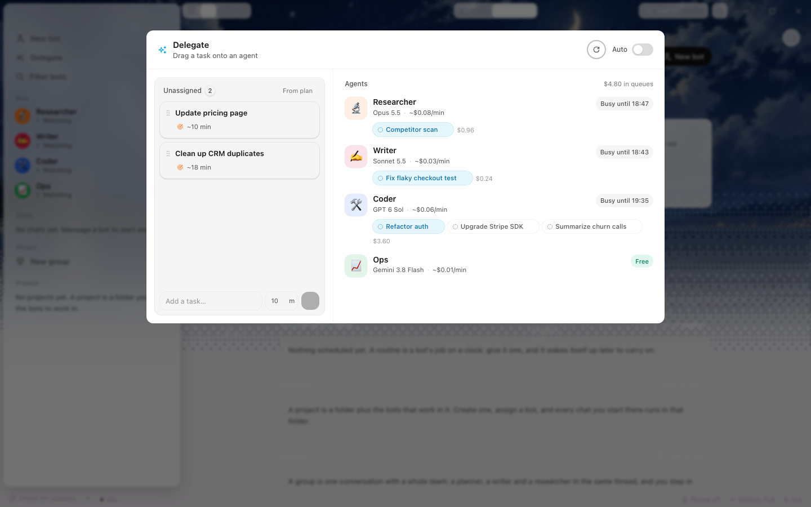

# Phases, skills, and the Delegate sheet (18 Oct 2026)

Session on `nightly/feature/delegation`. Three questions, then the branch's
first feature: **can a person see how the decision model hands work to models,
and change it?** The answer is the Delegate sheet; the audit that led to it is
below, because most of what limits delegation is what the phase pipeline does
not have yet.

Nothing here rewrites the plan in [PLAN-PHASES-2026-10-17.md](PLAN-PHASES-2026-10-17.md).
It records where that plan has landed, what that means for routing, and the
small surface this branch adds.

---

## 1. How a model is chosen today

**Selection is per role, not per phase.** `router.rs` knows two roles,
`Main` and `Sub`, plus an optional job key (`"workers"`, `"triage"`, and the
local-model picks). Phase never reaches the router:

| Phase | Who picks the model | Where | Per-phase? |
|---|---|---|---|
| Specify (Plan mode) | the thread's own `Route` — a different mechanism from `Router` | `chat.rs:1454-1466` | per thread, yes; per phase, no |
| Plan (tickets) | `Router` for the main agent, once per conversation | `harness.rs:1330-1334` → `router.rs:217` | no |
| Execute | `route_for(Sub, "workers", brief, context)` | `harness.rs:2954-2958` | no |
| Test | nothing | — | no |
| Ship | nothing | — | no |

`route_for(role, job, task, context)` (`router.rs:187`) and Jev's request body
(`router.rs:331-337`) carry `{role, task, context}`. There is no `phase` field
to carry, and no call site that would fill one.

### Ranked gaps

1. **High — plan mode does nothing on API routes.** `chat.rs` returns
   `Ok(req)` for every non-CLI route at `chat.rs:1532`, before the block that
   sets `req.edit`, the `"plan"` permission and `spec::prompt`
   (`chat.rs:1548-1557`). With a Router/Local/Cloud route no `SPEC.md` is ever
   written and gate 1 never runs. *Fix: move the plan block above the early
   return.*
2. **High — gates 3–5 do not exist.** Only `spec::check` (gate 1) and
   `plan_gate`/`plan_passed` (gate 2) record. `Phase::Test`, `Ship` and `Done`
   are unreachable outside `phase.rs`. No `TEST-PLAN.md`, `TEST-REPORT.md` or
   `RELEASE.md` anywhere. *Fix: one rules module per gate, mirroring `spec.rs`,
   then one model hook each.*
3. **High — escalation ignores the evidence the config advertises.** The comment
   and `default-config.toml` say a failed check or a rejection moves a worker up
   a rung. `escalate` is called only for an exhausted turn budget
   (`harness.rs:1986`), a detected loop (`harness.rs:2207`) and a manager's
   revise (`harness.rs:3222`). A failed ticket check (`harness.rs:2438-2457`)
   and a human rejection (`harness.rs:2470-2496`) return a failure without
   escalating. *Fix: call it in both branches, capped by `max_steps`.*
4. **Medium — `pin_main` discards the decision model's answer.** Any non-CLI
   pin (the default is Sonnet) overwrites `decision.model` at
   `router.rs:287-299`; Jev is left choosing effort only. *Fix: treat pins as a
   candidate filter and record the substitution in `Decision.note`.*
5. **Medium — resume re-routes from scratch.** Every dispatch calls
   `route_for` again (`harness.rs:2954`), so an interrupted API worker can come
   back on a different model, and a CLI session is only kept when the route is
   still the same kind. *Fix: persist the `Decision` on the agent and reuse it
   unless escalated.*
6. **Medium — decisions are not trace spans and are not cached.** The trace
   records the model but not the question, answer, source, confidence or cost
   (`harness.rs:851-862`); `Decision` lives in the agent log
   (`harness.rs:1498-1511`). A retry asks Jev again. *Fix: one span per
   decision; memoise on (role, job, hash(task, context)).*
7. **Medium — no per-phase budget.** Cost is checked project-wide
   (`harness.rs:1962-1965`) and per ticket, inside `drive`, after routing has
   already been paid for. Router spend is added to the project total but not to
   the agent (`harness.rs:1508-1510`).
8. **Low — `may_plan()` is dead code.** `phase.rs:116-118` is never called, so
   a project still in Specify can run human-filed tickets with `planned:false`.
9. **Low — effort clamping is silent.** `provider.rs` clamps to a model's
   `efforts`, but `Decision.effort` keeps the unclamped value that is shown and
   logged.

### What per-phase control would need

- `Router` takes the phase: `route_for(phase, role, job, task, context)`, with
  the phase as a quoted data field in Jev's state and as a tier floor in the
  heuristic.
- One `[router.phases]` table (`specify/plan/execute/test/ship = { model,
  effort, min_tier, max_usd }`) defaulting to today's behaviour.
- A persisted `Decision` per turn, one trace span each, reused on resume.
- A way for a human to open a gate: `record_spec` accepts only
  `GateBy::Rules` (`phase.rs:88-97`), so gate 1 has no human override.

The Delegate sheet in this branch is the first slice of the last item: it shows
which model each task is going to, and lets a human put it somewhere else.

---

## 2. Skills: add, delete, disable

**Add — yes, by folder.** `Skills::load` (`skills.rs:140-174`) reads
`~/.config/backspace/skills/<name>/` and `<project>/.backspace/skills/<name>/`.
Only a top-level `SKILL.md` makes a folder load; every top-level `*.md` beside
it is loaded as an auxiliary file. Only `description:` frontmatter is parsed
(`skills.rs:208-235`). No UI creates one: Settings → Agent skills offers
"Open my skills folder" and "Copy the template" and nothing else
(`ui/app.js:2290-2305`).

**Delete — not the built-ins.** The eight defaults are compiled in with
`include_str!` (`skills.rs:11-34`), so there is no file to remove. A user or
workspace folder of the same name **replaces** the built-in wholesale; deleting
that folder brings the built-in back. There is no disable switch at all: every
skill is listed in every prompt index (`harness.rs:989-992`) and loadable with
the `skill` tool (`harness.rs:2233-2239`). Config lists
(`main_skills`, `worker_skills`, `triage_skills`) only decide what is *injected*
into a role's prompt.

**The sharp edges.**

- A workspace override silently replaces a built-in for every agent, including
  Plan mode (`spec.rs:176`), and agents can write `.backspace/skills/`
  themselves through the `write` tool. A cloned repo can therefore ship a
  prompt that all roles pick up.
- A skill named in config but missing is skipped with no warning
  (`harness.rs:1000-1006`); prompts still refer to it and the `skill` tool later
  errors.
- `found()` reports a workspace override as "yours" because it checks the user
  folder first (`skills.rs:76-88`), while `load()` lets the workspace win.
- No reload: the harness caches `Skills` at open (`harness.rs:50,427`), so an
  edit needs the project reopened.
- CLI-routed workers get neither the index nor the `skill` tool.

**Minimal safe change:** a `disabled_skills` list in `WorkflowConfig`, filtered
in `Skills::load` and injection; `skill_add`/`skill_delete`/`skill_set_enabled`
commands that refuse to delete built-ins (disable only); slug validation; and a
per-skill toggle in Settings. None of it is in this branch.

---

## 3. The Delegate sheet

The mockup's board: Unassigned tasks on the left, the fleet on the right, each
bot with its model, an estimated minute price and a queue, an Auto switch, and
drag-and-drop between them.

**What it is.** A planning board, not a scheduler. A task is a title, an
estimate and the bot it is going to. Assigning a task does not spawn a worker or
open a branch; it records the attribution, who made it, and why, and shows what
that queue would cost. That is deliberately the first slice: the routing is
visible and overridable before anything is dispatched.

**Core** (`crates/core/src/delegate.rs`, 7 unit tests):

- `Board { auto, tasks }` in `<data>/delegation.json`, saved atomically.
- `Task { title, est_min, agent, source, note, ticket, … }`; `source` is
  `"manual"`, `"auto"`, or empty while unassigned.
- `auto_assign` fills unassigned tasks, oldest first, with the bot whose queue
  is shortest; ties go to the cheaper minute, then the older bot. The task's
  `note` records the decision ("auto · Researcher had the shortest queue (0
  min)").
- `snapshot` groups the board by bot and prices each queue:
  `usd_per_min = (input_usd_per_mtok·4000 + output_usd_per_mtok·1200) / 1e6`.
  A subscription CLI is free at the margin and reads "Free"; an unknown model is
  free rather than guessed.
- `from_tickets` imports the open project's unsettled tickets once each
  (keyed by ticket key; estimate `8 + 4·acceptance lines`, 5–120 min).

**Shell** (`crates/tauri-app/src/main.rs`): `delegate_state`, `delegate_add`,
`delegate_update`, `delegate_delete`, `delegate_assign`, `delegate_auto`,
`delegate_import`. Each write runs `auto_assign` before saving and returns the
priced snapshot, so the sheet needs one round trip.

**Face** (`crates/tauri-app/web/src/app/Delegate.tsx`): the sheet the mockup
draws — header, Auto switch, Unassigned well, agent rows with model, `~$/min`,
`Busy until`/`Free`, queue chips and queue cost. A card or chip can be dragged
to a bot or back to Unassigned; each task also has a keyboard/`select` path.
Chips show the assignment's `note` on hover. The sidebar row "Delegate" under
Chat → Agents opens it.

**Limits, on purpose.**

- The price is an estimate from token rates, not a meter.
- "Busy until" is when the queue *would* finish, not a running clock.
- Auto is a visible two-line rule, not the router. Wiring it to
  `router::heuristic`/Jev is the next step, and it needs the phase field from
  §1 to be worth doing.
- Nothing dispatches. "Import from plan" is the bridge to real work today.
