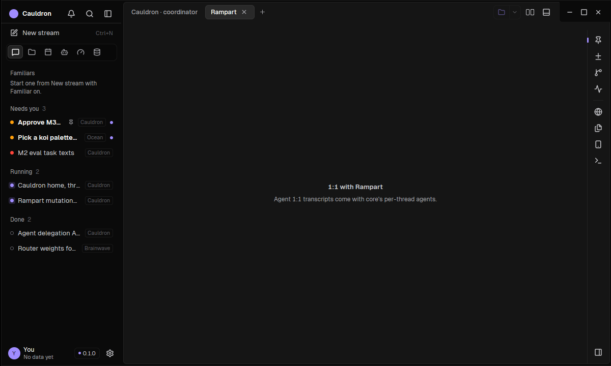
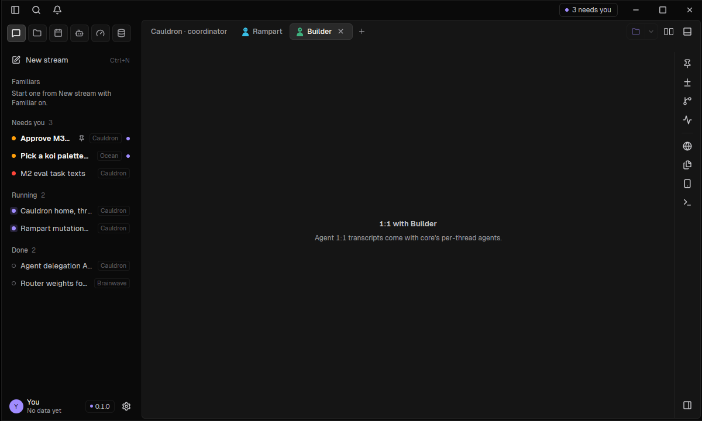
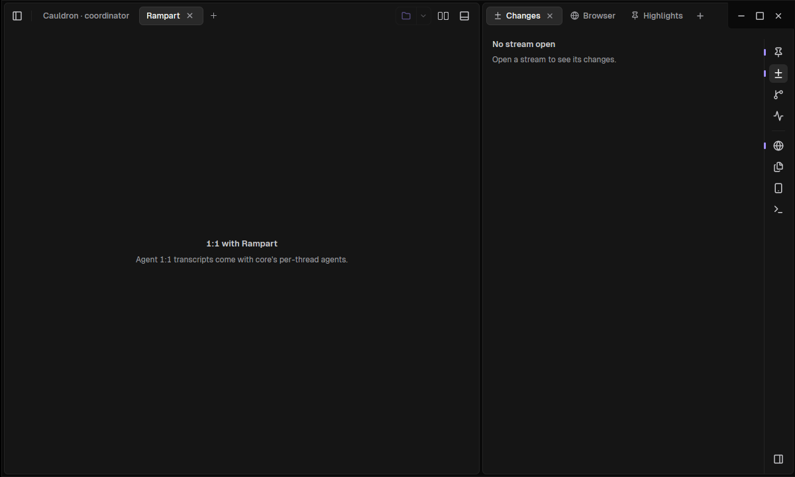
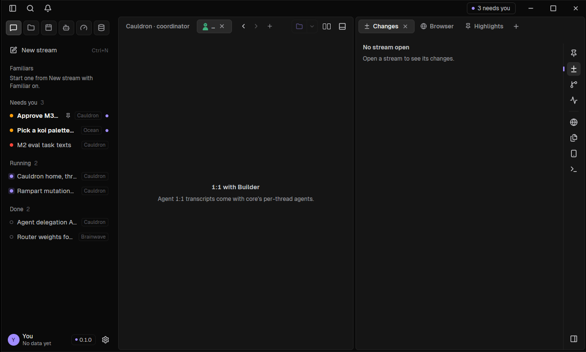
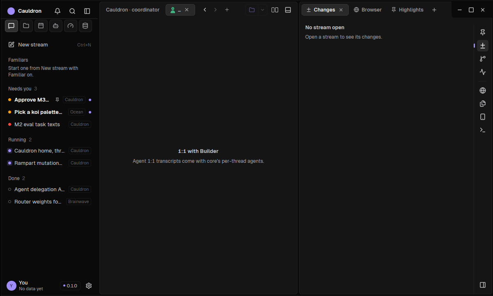
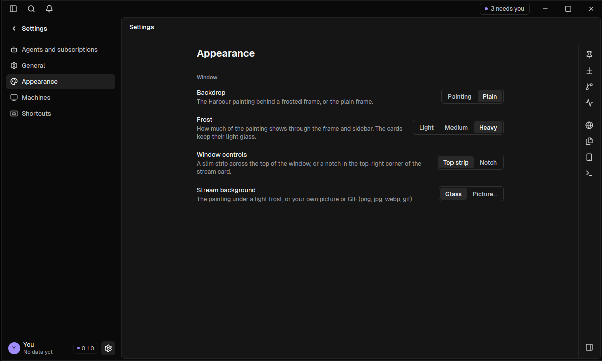

# Windows top strip, notch option, apps row, agent figures (20 Nov 2026)

Round 1: Charles asked to drop the notch for the older top bar and to find the missing agent design.
Round 2 (his reply): top bar B is the default (a slim strip, tabs stay in the card), the notch comes back as an
Appearance option, the apps are separate buttons above New stream, the right rail's mark shows only the open
panel, and streams get no agent figure (agents, familiars and captains do).
Direction board: `design/cauldron-top-bar-figures.html` (B picked). Shots are the real GPUI window under Xvfb,
1200x720, `CAULDRON_PLATFORM=windows`, fixture streams, Plain backdrop, dark.

| | Before (gg3ogp, notch) | After |
|---|---|---|
| Default, open |  |  |
| Default, support card |  |  |
| Notch option (Settings > Appearance > Window controls) | |  |
| The setting | |  |

Before shots are round 1's baseline (notch, one tray under New stream, dots).

Limits: not run on a real Windows PC; the notch option needs an app restart-free toggle but I only drove it by
saving the pref and relaunching in the capture; the figure is a still frame; "N needs you" counts streams only.
