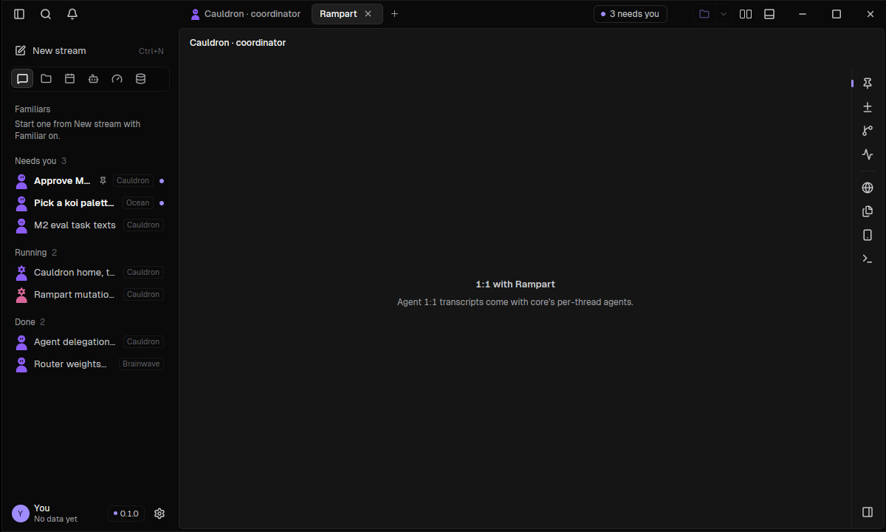
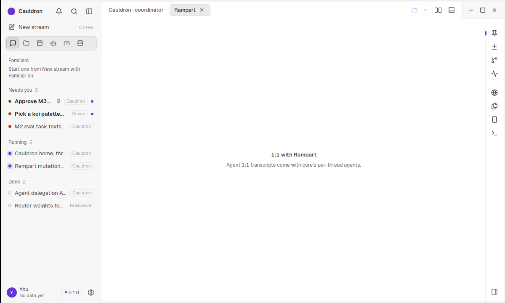
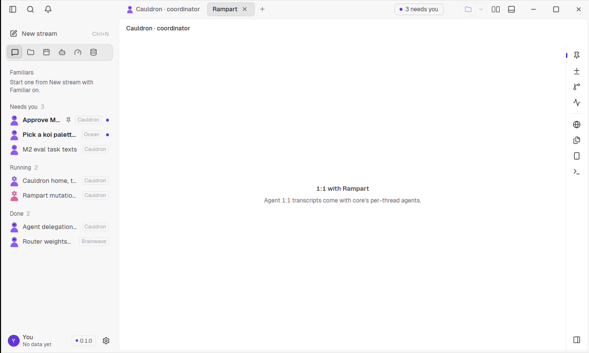
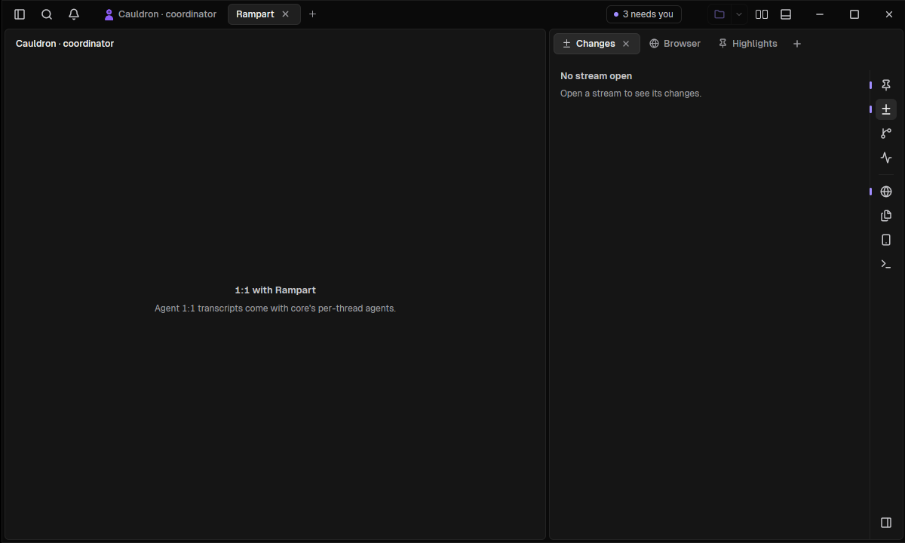
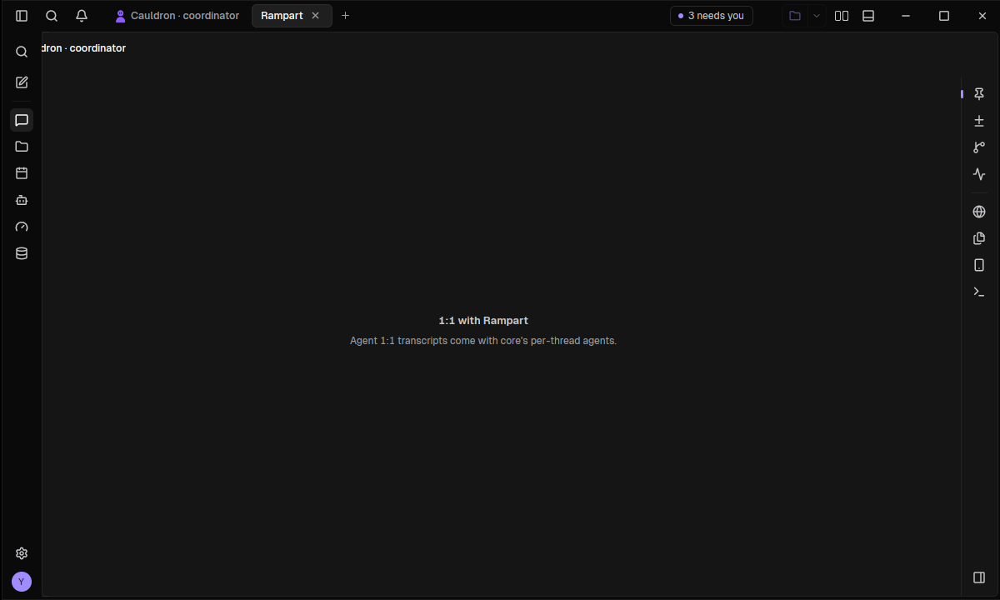

# Windows top bar and agent figures (20 Nov 2026)

Charles: drop the Windows notch for the older top bar, and bring back the agent design that was no longer in the app.
Direction board: `design/cauldron-top-bar-figures.html` (A, the full-width bar, picked over B, a slim strip).
Shots are the real GPUI window under Xvfb at 1200x720 with `CAULDRON_PLATFORM=windows`, fixture streams, Plain backdrop.

| | Before | After |
|---|---|---|
| Open, dark |  |  |
| Open, light |  |  |
| Folded, support card, dark |  |  |
| Folded, hover indent (after only) | |  |

What changed (Windows only; macOS is unchanged):
- 38px top bar across the window on the frame: sidebar button, search, inbox, the tabs, "N needs you", the tools, and the caption buttons at the right end. The notch is gone. The cards start under the bar.
- The sidebar's own top row (logo, name) is gone; its buttons moved into the bar.
- Agent figures are back (`crates/chrome/src/avatar.rs` was complete but nothing drew it): every stream row, the pinned tab, and the chat status line's outlined bust. Mood follows state: asking (needs you), error face (failed), cog (running), plain (done).
- Why they were gone: NL3 (38c24b7) removed them after the 13 Nov note "figures belong to the Agents page"; the Tight tiles rebuild kept dots and the Agents page never got them.

Limits: the figure is a still frame (the cog does not spin yet); other tabs than the pinned one are names only; the figure colour comes from the stream's agent name, so a stream with none is the coordinator's colour; "N needs you" counts streams only (familiars not included).
